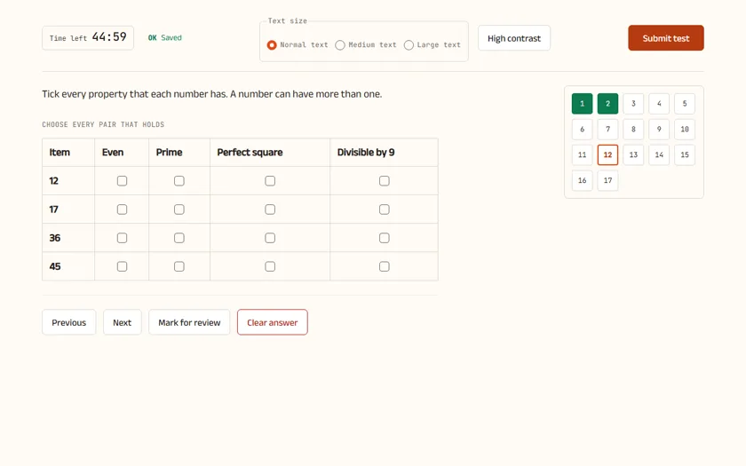
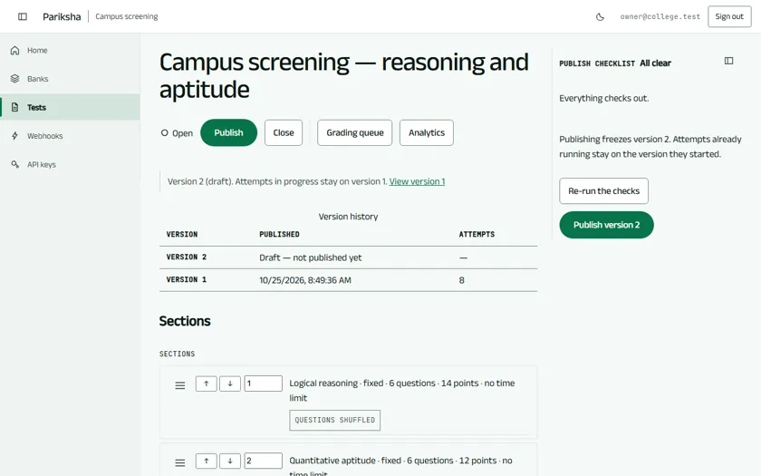
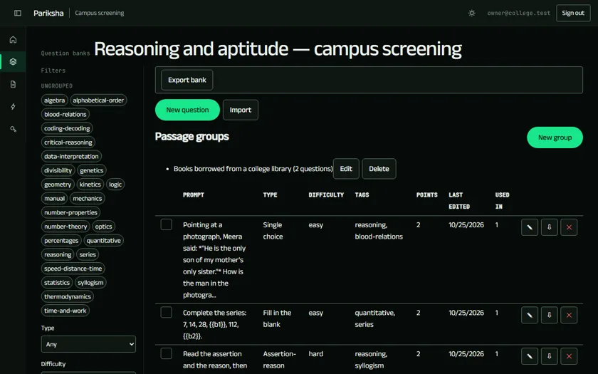
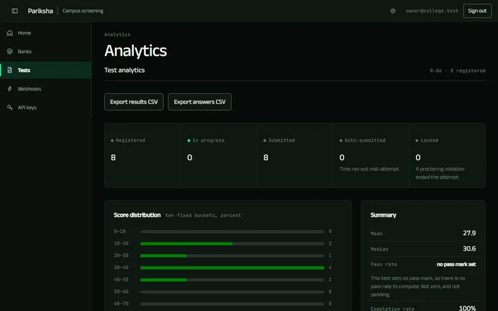
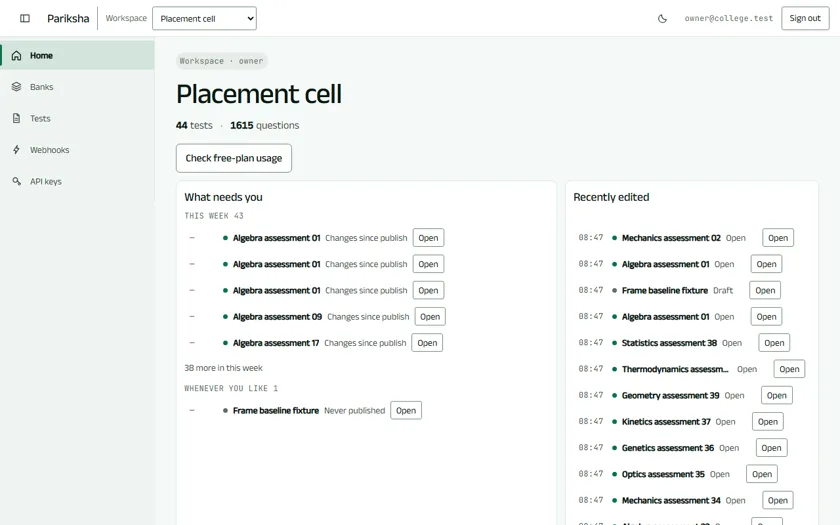
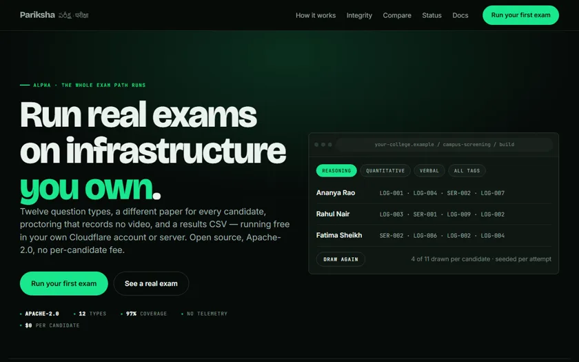
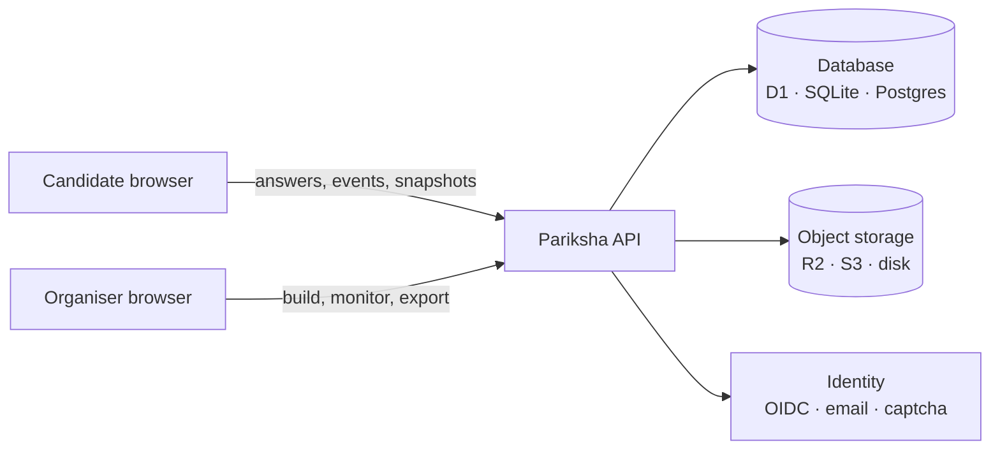

<div align="center">

<h1>Pariksha</h1>

<h3>పరీక్ష&nbsp;·&nbsp;परीक्षा</h3>

<p><b>Run real exams on the internet, for free, on infrastructure you own.</b></p>

<p>
Twelve question types&nbsp;· a different paper for every candidate&nbsp;· proctoring that records no video&nbsp;· a results CSV<br>
Your own Cloudflare account or your own server. AGPL-3.0, and no per-candidate fee, ever.
</p>

<p>
<a href="LICENSE"></a>
<a href="https://creativecommons.org/licenses/by/4.0/"></a>
<a href="#roadmap"></a>
<a href="docs/ROADMAP.md"></a>
<a href="CONTRIBUTING.md"></a>
</p>

<p>
<a href="#try-the-live-demo"><b>Try Live Demo</b></a>&nbsp;·
<a href="#screens">Screens</a>&nbsp;·
<a href="#what-it-does">What it does</a>&nbsp;·
<a href="#deployment-options">Deploy</a>&nbsp;·
<a href="#frequently-asked-questions">FAQ</a>&nbsp;·
<a href="#see-a-real-test">A real test</a>&nbsp;·
<a href="#documentation">Docs</a>&nbsp;·
<a href="#roadmap">Roadmap</a>&nbsp;·
<a href="#contributing">Contributing</a>
</p>

</div>

---

> ### Alpha — and here is exactly what that means
>
> **Built and on `main`:** deploy to your own Cloudflare account or Docker server, import a bank,
> build a test with pools and sets and a registration form, publish it, have
> candidates sit it under proctoring, grade the written answers, export the
> results CSV, or draft schema-validated questions using BYOK AI with Anthropic, OpenAI, Google Gemini, OpenRouter, or OpenCode. Phases 1&ndash;12, all completed.
>
> **Never done:** carried one real exam with 300 candidates at once. That is the
> v0.1 exit gate — one real test, 300+ candidates, zero lost answers — and it is
> the only thing between alpha and beta.
>
> **So:** run Pariksha beside what you use today rather than instead of it, and
> [tell us what bent](https://github.com/SriSatyaLokesh/pariksha/issues).

*Pariksha* — **పరీక్ష**, **परीक्षा** — means "examination".

## Try the Live Demo

You can test the candidate examination experience right now in your browser with zero setup, zero cost, and zero server calls:

### → **[Try the Live Candidate Demo](/exam?demo=true)** (Access Code: **`DEMO`**)

- **12 Question Types**: Single and multiple choice, true/false, fill-in-the-blank (`{{b1}}` and `[[b1]]`), numeric with tolerance, assertion–reason, matching (with multi-option mapping), ordering, select exactly K, and written responses.
- **Timed Sections**: 15 minutes total duration with 3 distinct 5-minute sections (Computer Science Fundamentals, Algorithms & Quantitative Analysis, Distributed Systems).
- **Floating Draggable Calculator**: A lightweight 4-function calculator modal (`z-index: 100`) with boundary-clamped dragging and arrow-key nudging that never gets obscured under question content.
- **Client-Side Proctoring**: Fullscreen lock, watermarking, copy-paste blocking, and dual-monitor detection with a 3-violation escalation limit and automatic local submission.
- **Instant Client-Side Grading**: Scored locally in pure TypeScript with instant feedback and answer review.

## Why

A college placement cell, a training institute or a 40-person company that needs to test 300 people has two options today:

| | Free form tools | Assessment platforms | **Pariksha** |
| --- | --- | --- | --- |
| Cost to run | Free | Per candidate or per month | **Free hosting tier, arithmetic published** |
| Question pools and sets | No | Yes | **Yes** |
| Rich question types | — | Varies by vendor | **12, including matching, ordering and numeric with tolerance** |
| Camera, fullscreen, tab-switch checks | No | Yes | **Yes** |
| Where candidate data lives | Their servers | Their servers | **Your account** |
| Answer keys hidden from the browser | No | Yes | **Yes** |
| You can read and change the code | No | No | **Yes** |

## What it does

- **Many tests, one deployment.** Each test gets its own name, `tst_` ID, URL, short link, QR code, sections and settings. Clone one, export it as JSON, import it somewhere else.
- **12 question types.** Single and multiple choice, select exactly K, true/false, assertion–reason, matching, multi-matching, ordering, fill in the blank, numeric with tolerance, short answer and long answer with a rubric. Markdown, code blocks, LaTeX and images in every one.
- **Different paper for every candidate.** Draw N questions from a pool filtered by tag and difficulty, or hand out fixed sets A/B/C round-robin so neighbours never match. Question and option order shuffles per candidate; pinned options stay put.
- **Scoring that matches your rules.** All-or-nothing, partial credit, negative marking, position-based for ordering, rubrics for written answers. Change a key afterwards and regrade every attempt, with an audit entry.
- **A registration form you design.** Eleven field types, server-side validation, "unique per test" fields that block repeat registrations, and a consent screen whose text you write.
- **Proctoring you choose — Off, Standard or Strict.** Desktop-only, fullscreen, tab-switch logging, copy/paste blocking, watermarking; and in Strict, camera, periodic snapshots, a violation limit and the four actions it can take, up to locking the attempt for an organiser to unlock. **No raw video or audio is permanently retained** (ADR 0012, PRD P-06) — Strict stores periodic JPEG stills behind signed URLs that expire in ten minutes. Supports native on-device face counting via the browser Shape Detection API (zero WASM, zero CSP changes, Issue #264), ambient microphone noise monitoring, and speech detection via the free browser Web Speech API ($0 cost) or workspace BYOK models (OpenAI Whisper & Google Gemini).
- **Flags, never verdicts.** Browser checks deter and record; they cannot prove cheating. Pariksha marks an attempt `clean`, `review` or `high_risk` and leaves the judgement to a person.
- **Results that fit your spreadsheet.** Grading queue with reviewer verdicts and regrade, item analysis (share correct, discrimination, option pick rates), a score distribution, a results CSV with one column per form field and section, per-answer and event CSVs, a snapshot manifest, scoped API keys and signed outbound webhooks. Includes the **Watchtower live monitor** (attempts updating live while the exam runs, with candidate broadcast messaging) and the per-attempt review screen with unobserved gap detection.
- **Privacy by design.** No telemetry, no third-party scripts, configurable retention, per-candidate export and deletion, an append-only audit log.
- **BYOK AI question drafting.** Generate complete, schema-validated questions directly from course topics, syllabi, or raw text using Anthropic (Claude 3.7 / 3.5 Sonnet, 3.5 Haiku), OpenAI (GPT-4o, o1, o3-mini), Google Gemini (Gemini 2.5 Pro / 2.5 Flash), OpenRouter (DeepSeek, Llama 3.3, Mistral), or OpenCode (open & local models). Pure native `fetch`, WebCrypto AES-256-GCM zero-knowledge key encryption at rest, hard monthly spend caps, and interactive in-modal review with schema validation badges, 1-click question flagging/exclusion, and inline editing before bank import.
- **Two deployment targets: Cloudflare serverless and Docker self-host.** Every adapter — database, object storage, identity — exists for both. Deploy on Cloudflare's free tier (Workers, D1, R2) with zero operational cost, or self-host on any Linux server, VPS, or air-gapped on-premise network with Docker Compose (Postgres 16 / SQLite, MinIO, and Caddy for automatic HTTPS). See the [Deployment Guide](docs/deployment.md).

## Screens

Six captures of the running application — headless Chromium against the built
app on a seeded instance, all from
[`marketing-shots.spec.ts`](apps/web/e2e/measurement/marketing-shots.spec.ts).
No mockups, no retouching. **Click any one for full size.**

The organiser is on the Signal dark ground, which is what a visitor gets by
default. **The candidate's paper is warm on purpose** — an accent cannot cross
grounds (`signal-accent` is 1.60:1 on cream), so the exam keeps its own ground
and its own accent while the organiser moved to Signal. That ruling is
[ADR 0010](docs/adr/0010-the-organiser-moves-to-the-signal-ground.md).

<table>
<tr>
<td width="50%">
<a href="docs/screens/exam-runner.webp"></a>
<b>The candidate's paper.</b> Server clock, offline save queue, a palette that survives a reload. Its own cream ground, by the rule above. The question shown is multi-matching.
</td>
<td width="50%">
<a href="docs/screens/test-builder.webp"></a>
<b>The test builder.</b> Fixed lists, pools or sets; numbered frozen versions; one publish checklist the server and the screen compute alike.
</td>
</tr>
<tr>
<td width="50%">
<a href="docs/screens/bank-browser.webp"></a>
<b>Question banks.</b> Twelve types with live preview, passage groups, tag and difficulty filters. Shown: <a href="examples/reasoning-aptitude/">the worked example</a>, imported as itself.
</td>
<td width="50%">
<a href="docs/screens/analytics.webp"></a>
<b>Results and analytics.</b> Attempt counts by state, score distribution, item analysis, and the results and per-answer CSVs beside them.
</td>
</tr>
<tr>
<td width="50%">
<a href="docs/screens/organiser-home.webp"></a>
<b>Home.</b> What needs you, what you touched last, the free-plan usage meter — per workspace, roles enforced on the server.
</td>
<td width="50%">
<a href="docs/screens/landing.webp"></a>
<b>The public page.</b> Static output, no backend call, prerendered at build time — the ground the organiser now shares.
</td>
</tr>
</table>

<sub>Re-take: <code>pnpm --filter @pariksha/web e2e</code> writes PNGs to
<code>apps/web/e2e/screenshots/</code> (git-ignored). Convert with
<code>ffmpeg -i in.png -vf scale=840:-1 -quality 82 docs/screens/out.webp</code>
— 840&nbsp;px WebP is 152&nbsp;KB for all six against 692&nbsp;KB of
full-size PNG, and this page loads every one of them.</sub>

## What is still to come

Phases 1–12 and 8.5 (The Watchtower & The Ear) are completed (including Phase 8.5 Live Monitor, Phase 8.5 Ambient Noise Monitoring, Native Face Counting, Free Browser Web Speech Recognition & BYOK Whisper/Gemini Audio Models, Phase 9 Public Demo & Section Palette, Phase 10 Docker Self-Host, Phase 11 Multi-Target Deployment & v1.0 Release Readiness, and Phase 12 BYOK AI Question Drafting). What is scheduled next, with the phase that owns it —
[`docs/ROADMAP.md`](docs/ROADMAP.md) is authoritative:

| Not built yet | Phase |
| --- | --- |
| One real exam with 300+ candidates — **the gate that ends alpha** | v0.1 exit gate |

## See a real test

The fastest way to understand Pariksha is to read one test end to end:

### → **[examples/reasoning-aptitude/](examples/reasoning-aptitude/)**

A 45-minute campus screening round in reasoning and aptitude. The folder walks through **what the organiser writes, what the candidate sees, and what comes out**:

| | |
| --- | --- |
| [`questions.json`](examples/reasoning-aptitude/questions.json) | 17 questions with keys and explanations — covering all 12 types |
| [`test.json`](examples/reasoning-aptitude/test.json) | Timing, access code, registration form, three sections (pool, sets, fixed), scoring, release |
| [`candidates.csv`](examples/reasoning-aptitude/candidates.csv) | The list of who may take it |
| [`results.csv`](examples/reasoning-aptitude/results.csv) | What you download afterwards |
| [`README.md`](examples/reasoning-aptitude/README.md) | The registration form, the test screen, a violation warning and the scoring, drawn out screen by screen |

That folder's own README draws the candidate's screen with a per-section timer and a palette grouped by section, matching the shipped candidate runner runtime.

## How it works



The API and all scoring logic are plain TypeScript written against three adapter interfaces — database, object storage, identity — so the same code runs on Cloudflare Workers or in a Docker container. Answer keys, timing and permissions are enforced **only** on the server.

Full architecture, candidate journey and data model: the [PRD](docs/PRD.md). High-resolution diagrams: [`docs/architecture-diagrams/`](docs/architecture-diagrams/).

## Documentation

| Document | What it covers |
| --- | --- |
| [Product requirements (PRD)](docs/PRD.md) | Scope, roles, question types, proctoring, security, acceptance criteria, roadmap |
| [Deployment Guide](docs/deployment.md) | Full setup for Cloudflare serverless, Docker (Postgres/SQLite), and on-premise air-gapped labs |
| [Question format](docs/question-format.md) | `pariksha/question@1` — the 12 types and how they are scored |
| [Test format](docs/test-format.md) | `pariksha/test@1` — timing, access, registration form, sections, release |
| [Worked example](examples/reasoning-aptitude/) | One whole test, from input to results CSV |
| [Design system](DESIGN.md) | `DESIGN.md` — colours, type, components and the rules behind them, machine-readable |
| [Architecture decisions](docs/adr/) | Why Cloudflare + adapters, why AGPL-3.0 |
| [JSON Schemas](schemas/) | Machine-readable question, bank and test schemas |
| [Build roadmap](docs/ROADMAP.md) | The twelve phases, what each one shipped, and what it deliberately left behind. **Authoritative on what is built** |
| [Exports](docs/exports.md) and [webhooks](docs/webhooks.md) | The results, per-answer and event CSVs; signed outbound webhooks and scoped API keys |
| [Deploy on Cloudflare](deploy/cloudflare/README.md) | The one-Worker topology, the setup script, and why it is one Worker and not two |
| [Phase plans](docs/superpowers/plans/) | How each phase was built, task by task, with the deferrals recorded rather than lost |

## Repository layout

```text
pariksha/
├── apps/
│   ├── web/              # candidate and admin interfaces (React + Vite)
│   └── api/              # HTTP API (Hono) for Cloudflare Workers and Node
├── packages/
│   ├── core/             # question types, scoring, policies (pure TypeScript)
│   ├── db/               # Drizzle schema and migrations (D1, SQLite, Postgres)
│   └── storage/          # R2, S3 and local-disk adapters
├── deploy/
│   ├── cloudflare/       # zero-cost reference deployment
│   └── docker/           # self-host with Docker Compose (Postgres/SQLite, MinIO, Caddy)
├── docs/                 # PRD, format specs, ADRs, diagrams
├── schemas/              # JSON Schemas (question, bank, test)
├── examples/             # complete worked tests, one folder per subject
└── .github/              # issue and PR templates, CI
```

## Deployment Options

Pariksha offers two zero-licensing-fee deployment paths. Read the comprehensive **[Deployment Guide](docs/deployment.md)** for detailed architectures, hardware sizing, and on-premises air-gapped instructions.

### 1. Cloudflare Serverless (Zero Maintenance)

Deploy on Cloudflare's free tier (100k requests/day, 10 GB storage, $0/month) with one Worker serving Static Assets and the Hono API, plus D1 and R2:

```bash
# Provision Cloudflare resources and deploy
node deploy/cloudflare/setup.mjs
pnpm deploy:cf
```

Details in [`deploy/cloudflare/README.md`](deploy/cloudflare/README.md).

### 2. Docker Compose (Self-Host & On-Premises)

Deploy on any Linux server, VPS ($4/mo), or local machine with Docker Compose and automatic Let's Encrypt HTTPS:

```bash
cd deploy/docker
cp .env.example .env

# Option A: Lightweight SQLite (~80 MB RAM)
docker compose -f docker-compose.sqlite.yml up -d --build

# Option B: Production PostgreSQL 16 + MinIO S3 cluster (~350 MB RAM)
docker compose up -d --build
```

Details in [`deploy/docker/README.md`](deploy/docker/README.md) and the [Deployment Guide](docs/deployment.md).

## Running Pariksha locally

Node 22+ and pnpm 10. The API and the web app are separate processes, and the browser must reach both on **one origin** — the session cookie is `HttpOnly`, `SameSite=Lax` and `Secure`, so a cross-origin pair behaves nothing like a deployment. `apps/web/vite.config.ts` proxies `/api` to port 8787 for exactly that reason, which is why you open the Vite URL and never the API's.

```bash
pnpm install
pnpm build          # SITE_URL is required by the landing-page prerender
                    # — SITE_URL="https://pariksha.example" pnpm build

# Terminal 1 — the API. It migrates the database on boot, so a path that
# does not exist yet is a new, empty instance.
SESSION_SECRET="$(openssl rand -hex 32)" \
DATABASE_URL=./pariksha.sqlite \
STORAGE_DIR=./files \
PUBLIC_URL=http://localhost:5173 \
  node apps/api/dist/node.js

# Terminal 2 — the web app, on http://localhost:5173
pnpm --filter @pariksha/web dev
```

The organiser app is `http://localhost:5173/admin.html`: sign in, name your first workspace, and you are the owner of the instance. `/` is the landing page, which only has content after `pnpm build` runs the prerender — under `vite dev` it is deliberately empty.

**You need a sign-in method before anyone can sign in.** On the Node target (this local run and Docker), email-and-password sign-in is on by default, and while no workspace exists the first registration is open, so a fresh local instance needs nothing else. On Cloudflare there is no password sign-in, so the first owner has to come from an OIDC provider. With nothing available, the sign-in page says so rather than offering a form that cannot work. Step-by-step setup, including Google, Docker and Cloudflare, is in [docs/contributing/setup.md](docs/contributing/setup.md).

| Variable | What it gives you |
| --- | --- |
| `OIDC_PROVIDERS` | A JSON array of `{ id, label, issuer, clientId, clientSecret, redirectUri }`. The way to sign in on a brand-new Cloudflare instance — a magic link is sent to accounts that already exist, and a fresh instance has none. (Node and Docker can also use password sign-in.) |
| `EMAIL_ENDPOINT`, `EMAIL_TOKEN`, `EMAIL_FROM` | Magic-link sign-in through any transactional-email HTTP endpoint. |
| `EMAIL_CONSOLE=true` | Prints the magic-link email to the server log instead of sending it. Refused in production unless you set it deliberately — a sign-in link in a log is a sign-in link. |
| `APP_URL` | The origin magic-link URLs are built against. |
| `PORT` | The API's port. Defaults to 8787, which is what the Vite proxy expects. |

To see the whole first run work without configuring any of that:

```bash
pnpm --filter @pariksha/web e2e
```

That walks a browser from the landing page to a signed-in, empty dashboard against an in-memory database and an OpenID provider that exists only in `apps/web/e2e/stub-idp.mjs`. It touches no network and leaves nothing behind, so every run is a first run.

## Validating questions without installing anything

The formats are published and stable, so a bank can be written and checked
before Pariksha is anywhere near it — and the same file imports unchanged:

```bash
git clone https://github.com/SriSatyaLokesh/pariksha.git
cd pariksha

npx -y -p ajv-cli@5.0.0 -p ajv-formats@2.1.1 ajv validate --spec=draft2020 --strict=false -c ajv-formats \
  -s schemas/bank-1.json -r schemas/question-1.json -d "examples/*/questions.json"

npx -y -p ajv-cli@5.0.0 -p ajv-formats@2.1.1 ajv validate --spec=draft2020 --strict=false -c ajv-formats \
  -s schemas/test-1.json -d "examples/*/test.json"
```

Write your own questions, validate them, and import them whole — Pariksha JSON, CSV or Moodle GIFT, all-or-nothing with a line-by-line error report.

## Roadmap

| Release | Focus | State |
| --- | --- | --- |
| **v0.1 Pilot-ready** | All 12 question types, question banks and authoring, the test builder (sets, pools, registration forms, access codes), the candidate runtime, Cloudflare deploy | **Built** — waiting on its exit gate |
| **v0.2 Teams and security** | Workspaces, roles, OIDC sign-in, invite links, email codes, audit log, retention jobs, Standard and Strict proctoring, live monitor, CSV export | **Built except the live monitor** (Phase 8.5) |
| **v0.3 Grading and analytics** | Grading queue, item analysis, per-set comparison, regrade | **Built** |
| **v1.0 Public release** | Docker + Postgres, REST API, webhooks, CSV and GIFT import, plugins, WCAG 2.1 AA, translations, signed releases | Webhooks, API keys and CSV/GIFT import built; the rest is Phases 9–12 |

Each release has an exit gate, and **v0.1's is the one that matters right now:
one real test with 300+ candidates and zero lost answers.** The features are
there; that run has not happened. If you have a cohort that size and the
appetite to run Pariksha alongside whatever you use today, open an issue —
that is the single most useful contribution available.

Details: [PRD roadmap](docs/PRD.md#roadmap). **`docs/ROADMAP.md` is authoritative on phasing** — where the two disagree, re-read that file rather than this table.

## Frequently Asked Questions

### What makes Pariksha different from Google Forms, Moodle, or Canvas?
Pariksha is purpose-built for high-integrity examinations with zero external telemetry. Unlike Google Forms, it provides server-authoritative timers, randomized question pools so no two candidates receive the same paper, and 12 specialized question types with LaTeX and code rendering. Unlike heavy LMS platforms like Moodle or Canvas, Pariksha is lightweight, compiles to zero runtime JavaScript on landing pages, and runs serverless on Cloudflare's free tier or as a lean Docker container with zero per-candidate licensing fees.

### How does Pariksha enforce proctoring without violating candidate privacy?
Pariksha rejects invasive continuous video/audio surveillance and AI facial biometric analysis. Instead, its proctoring captures low-resolution 320×240 periodic JPEG snapshots (under 25 KB) alongside full-screen lock and tab-switch event logging. All snapshot assets are stored strictly in the organiser's own private storage bucket (Cloudflare R2 or MinIO S3) behind 10-minute expiring signed URLs.

### What deployment options are available for air-gapped or on-premise environments?
Pariksha supports fully air-gapped, isolated campus LAN deployments via Docker Compose. The self-hosted stack includes PostgreSQL 16 (or lean SQLite), MinIO for S3-compatible asset storage, and Caddy for automatic local TLS termination. The platform has zero outbound network calls, zero telemetry scripts, and zero dependency on external DNS or Cloudflare services. Detailed instructions are available in the [Deployment Guide](docs/deployment.md).

### What question types can be authored and scored?
Pariksha natively supports 12 authorable question types: single choice, multiple choice, select exactly K, true/false, assertion–reason, matching, multi-matching, ordering, fill-in-the-blank (with bracket syntax), numeric with tolerance, short answer, and long answer with custom rubrics. Scoring modes include all-or-nothing, partial credit, and negative marking.

## Contributing

Pariksha is at a good moment to join: the product is built and the hard part
left is *use* — running it, breaking it, and telling us where it bent.

**You do not need to write TypeScript to help.** The most valuable contributions right now are:

| | |
| --- | --- |
| 🧪 **Run a real exam** | Deploy it, put a real cohort through it, and report what happened. This is the v0.1 exit gate and the one thing no amount of code closes |
| 🐞 **Break it and say how** | A reproduction against a local instance is worth more than a code change; the issue templates ask for exactly what we need |
| 📝 **Question sets** | Add a subject under [`examples/`](examples/) — school science, GATE-style engineering, nursing, language comprehension, civil-service reasoning, your own field. Original content only, CC BY 4.0 |
| 🌐 **Translations** | Interface strings and candidate-facing text in Indian and other languages to extend the i18n registry shipped in Phase 11 |
| ♿ **Accessibility** | Screen-reader usability feedback across devices to build upon the automated WCAG 2.1 AA audit suite |
| 💻 **Code** | Phases 1–12 are completed, so there is a mature codebase to work in: see [the roadmap](docs/ROADMAP.md), the [Model Router Contributor Guide](docs/contributing/ai-model-router.md) ([#261](https://github.com/SriSatyaLokesh/pariksha/issues/261)), and open issues |

Start with [CONTRIBUTING.md](CONTRIBUTING.md) and the [Code of Conduct](CODE_OF_CONDUCT.md). Security issues go through [SECURITY.md](SECURITY.md) — never a public issue.

## Contributors

Everyone who has shaped Pariksha is listed in [CONTRIBUTORS.md](CONTRIBUTORS.md), in every form of contribution — code, questions, docs, translations, review, bug reports. Open a pull request and add yourself.

[](https://github.com/SriSatyaLokesh/pariksha/graphs/contributors)

Maintainers are listed in [MAINTAINERS.md](MAINTAINERS.md).

## Licence

Code is licensed under the [GNU Affero General Public License 3.0 (AGPL-3.0)](LICENSE) — self-host it, modify it, embed it. The network-use clause ensures improvements to hosted services remain open. Documentation, the JSON Schemas in [`schemas/`](schemas/) and the sample tests in [`examples/`](examples/) are licensed under [CC BY 4.0](https://creativecommons.org/licenses/by/4.0/).

The reasoning behind that choice is recorded in [ADR 0013](docs/adr/0013-license-agpl-v3.md).

© 2026 Satya K and the Pariksha contributors.
