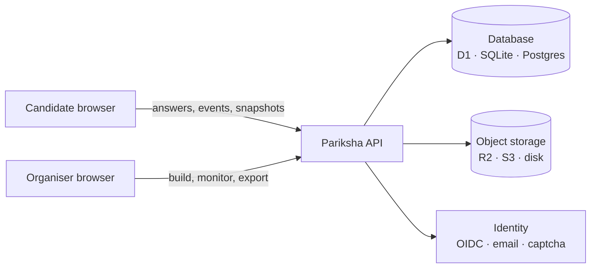

<div align="center">

# Pariksha

**Run real exams on the internet, for free, on infrastructure you own.**

Question pools, 12 question types, browser proctoring, a registration form builder and CSV results — self-hosted in under 30 minutes, at zero hosting cost.

[](LICENSE)
[](https://creativecommons.org/licenses/by/4.0/)
[](#roadmap)
[](CONTRIBUTING.md)

[What it does](#what-it-does) · [See a real test](#see-a-real-test) · [Docs](#documentation) · [Roadmap](#roadmap) · [Contributing](#contributing)

</div>

---

> **Status: pre-alpha.** This repository holds the product requirements, the open question and test formats, their JSON Schemas, and a complete worked example. **Code lands with v0.1.** Everything here is reviewable, and the formats are stable enough to write questions against today. Issues and pull requests are open — see [good first issues](#contributing).

*Pariksha* (परीक्षा) means "examination" in Hindi and several other Indian languages.

## Why

A college placement cell, a training institute or a 40-person company that needs to test 300 people has two options today:

| | Free form tools | Assessment platforms | **Pariksha** |
| --- | --- | --- | --- |
| Cost | Free | Per candidate, per month | **Free** |
| Question pools and sets | No | Yes | **Yes** |
| Rich question types | 3–4 | Yes | **12** |
| Camera, fullscreen, tab-switch checks | No | Yes | **Yes** |
| Where candidate data lives | Their servers | Their servers | **Your account** |
| Answer keys hidden from the browser | No | Yes | **Yes** |
| You can read and change the code | No | No | **Yes** |

## What it does

- **Many tests, one deployment.** Each test gets its own name, `tst_` ID, URL, short link, QR code, sections and settings. Clone one, export it as JSON, import it somewhere else.
- **12 question types.** Single and multiple choice, select exactly K, true/false, assertion–reason, matching, multi-matching, ordering, fill in the blank, numeric with tolerance, short answer and long answer with a rubric. Markdown, code blocks, LaTeX and images in every one.
- **Different paper for every candidate.** Draw N questions from a pool filtered by tag and difficulty, or hand out fixed sets A/B/C round-robin so neighbours never match. Question and option order shuffles per candidate; pinned options stay put.
- **Scoring that matches your rules.** All-or-nothing, partial credit, negative marking, position-based for ordering, rubrics for written answers. Change a key afterwards and regrade every attempt, with an audit entry.
- **A registration form you design.** Eleven field types, server-side validation, "unique per test" fields that block repeat registrations, and a consent screen whose text you write.
- **Proctoring you choose — Off, Standard or Strict.** Desktop-only, fullscreen, tab-switch logging, copy/paste blocking, watermarking; and in Strict, camera, periodic snapshots, on-device face counting and violation limits. **No video or audio is ever recorded.**
- **Flags, never verdicts.** Browser checks deter and record; they cannot prove cheating. Pariksha marks an attempt `clean`, `review` or `high_risk` and leaves the judgement to a person.
- **Results that fit your spreadsheet.** Live monitor, grading queue, item analysis, a results CSV with one column per form field and section, per-answer and event exports, a REST API and signed webhooks.
- **Privacy by design.** No telemetry, no third-party scripts, configurable retention, per-candidate export and deletion, an append-only audit log.
- **Two deployment targets, one codebase.** Cloudflare's free plan (Pages, Workers, D1, R2) or Docker on any server (Node, SQLite or Postgres, S3/MinIO).

## See a real test

The fastest way to understand Pariksha is to read one test end to end:

### → **[examples/reasoning-aptitude/](examples/reasoning-aptitude/)**

A 45-minute campus screening round in reasoning and aptitude. The folder walks through **what the organiser writes, what the candidate sees, and what comes out**:

| | |
| --- | --- |
| [`questions.json`](examples/reasoning-aptitude/questions.json) | 17 questions with keys and explanations — covering all 12 types |
| [`test.json`](examples/reasoning-aptitude/test.json) | Timing, access code, registration form, three sections (pool, sets, fixed), scoring, release |
| [`candidates.csv`](examples/reasoning-aptitude/candidates.csv) | The list of who may take it |
| [`results.csv`](examples/reasoning-aptitude/results.csv) | What you download afterwards |
| [`README.md`](examples/reasoning-aptitude/README.md) | The registration form, the test screen, a violation warning and the scoring, drawn out screen by screen |

A taste of the candidate's screen:

```
┌──────────────────────────────────────────────────────────────┐
│ Section 2 of 3 · Logical reasoning     Section 08:41 ▸ Total 22:10 │
├────────────────────────────────────────────┬─────────────────┤
│  Question 6 of 12                   2 pts  │  Questions      │
│                                            │  Section 1      │
│  What comes next in the series?            │  ① ② ③ ④        │
│      3, 7, 15, 31, 63, ?                   │  Section 2      │
│                                            │  ⑤ ⑥ ⑦ ⑧        │
│   ( ) 95     (•) 127                       │  Section 3      │
│   ( ) 117    ( ) 131                       │  🔒 locked      │
├────────────────────────────────────────────┴─────────────────┤
│  ✓ Saved 2 seconds ago                     Ananya Rao 21CS0147│
└──────────────────────────────────────────────────────────────┘
```

## How it works



The API and all scoring logic are plain TypeScript written against three adapter interfaces — database, object storage, identity — so the same code runs on Cloudflare Workers or in a Docker container. Answer keys, timing and permissions are enforced **only** on the server.

Full architecture, candidate journey and data model: the [PRD](docs/PRD.md). High-resolution diagrams: [`docs/architecture-diagrams/`](docs/architecture-diagrams/).

## Documentation

| Document | What it covers |
| --- | --- |
| [Product requirements (PRD)](docs/PRD.md) | Scope, roles, question types, proctoring, security, acceptance criteria, roadmap |
| [Question format](docs/question-format.md) | `pariksha/question@1` — the 12 types and how they are scored |
| [Test format](docs/test-format.md) | `pariksha/test@1` — timing, access, registration form, sections, release |
| [Worked example](examples/reasoning-aptitude/) | One whole test, from input to results CSV |
| [Architecture decisions](docs/adr/) | Why Cloudflare + adapters, why Apache-2.0 |
| [JSON Schemas](schemas/) | Machine-readable question, bank and test schemas |

## Repository layout

```text
pariksha/
├── apps/
│   ├── web/              # candidate and admin interfaces (React + Vite)
│   └── api/              # HTTP API (Hono) for Cloudflare Workers and Node
├── packages/
│   ├── core/             # question types, scoring, policies (pure TypeScript)
│   ├── db/               # Drizzle schema and migrations (D1, SQLite, Postgres)
│   └── storage/          # R2, S3 and local-disk adapters
├── deploy/
│   ├── cloudflare/       # zero-cost reference deployment
│   └── docker/           # self-host with Docker Compose
├── docs/                 # PRD, format specs, ADRs, diagrams
├── schemas/              # JSON Schemas (question, bank, test)
├── examples/             # complete worked tests, one folder per subject
└── .github/              # issue and PR templates, CI
```

## Try the formats today

No install needed — validate the examples against the schemas:

```bash
git clone https://github.com/SriSatyaLokesh/pariksha.git
cd pariksha

npx -y -p ajv-cli@5.0.0 -p ajv-formats@2.1.1 ajv validate --spec=draft2020 --strict=false -c ajv-formats \
  -s schemas/bank-1.json -r schemas/question-1.json -d "examples/*/questions.json"

npx -y -p ajv-cli@5.0.0 -p ajv-formats@2.1.1 ajv validate --spec=draft2020 --strict=false -c ajv-formats \
  -s schemas/test-1.json -d "examples/*/test.json"
```

Write your own questions, validate them, and they will import into Pariksha on day one.

## Roadmap

| Release | Focus |
| --- | --- |
| **v0.1 Pilot-ready** | Tests with IDs and URLs, sets and pools, 6 core question types, registration forms, access codes, Standard and Strict proctoring, live monitor, CSV export, Cloudflare deploy |
| **v0.2 Teams and security** | Workspaces, roles, OIDC sign-in, invite links, email codes, audit log, retention jobs |
| **v0.3 All question types** | Remaining question types, partial and negative scoring, grading queue, item analysis, regrade |
| **v1.0 Public release** | Docker + Postgres, REST API, webhooks, CSV and GIFT import, plugins, WCAG 2.1 AA, translations, signed releases |

Each release has an exit gate — v0.1's is one real test with 300+ candidates and zero lost answers. Details: [PRD roadmap](docs/PRD.md#roadmap).

## Contributing

Pariksha is at the best possible moment to join: the shape is decided, the code is not yet written, and an early contributor still gets to decide how large parts of it work.

**You do not need to write TypeScript to help.** The most valuable contributions right now are:

| | |
| --- | --- |
| 📝 **Question sets** | Add a subject under [`examples/`](examples/) — school science, GATE-style engineering, nursing, language comprehension, civil-service reasoning, your own field. Original content only, CC BY 4.0 |
| 🌐 **Translations** | Interface strings and candidate-facing text in Indian and other languages |
| 🔍 **Review the design** | Read the [PRD](docs/PRD.md) and argue with it in an issue. Especially the [open questions](docs/PRD.md#risks-and-open-questions) |
| 🧪 **Formats** | Try writing a real test in [`pariksha/test@1`](docs/test-format.md) and tell us what you could not express |
| 💻 **Code** | From v0.1: `packages/core` (scoring), `apps/api` (Hono), `apps/web` (React) |

Start with [CONTRIBUTING.md](CONTRIBUTING.md) and the [Code of Conduct](CODE_OF_CONDUCT.md). Security issues go through [SECURITY.md](SECURITY.md) — never a public issue.

## Contributors

Everyone who has shaped Pariksha is listed in [CONTRIBUTORS.md](CONTRIBUTORS.md), in every form of contribution — code, questions, docs, translations, review, bug reports. Open a pull request and add yourself.

[](https://github.com/SriSatyaLokesh/pariksha/graphs/contributors)

Maintainers are listed in [MAINTAINERS.md](MAINTAINERS.md).

## Licence

Code is licensed under the [Apache License 2.0](LICENSE) — self-host it, modify it, embed it, offer it commercially. Documentation, the JSON Schemas in [`schemas/`](schemas/) and the sample tests in [`examples/`](examples/) are licensed under [CC BY 4.0](https://creativecommons.org/licenses/by/4.0/).

The reasoning behind that choice is recorded in [ADR 0003](docs/adr/0003-license-apache-2-0.md).

© 2026 Satya K and the Pariksha contributors.
