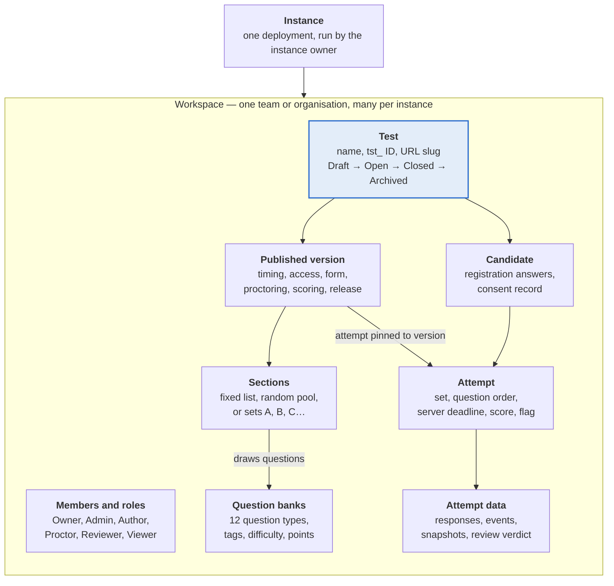
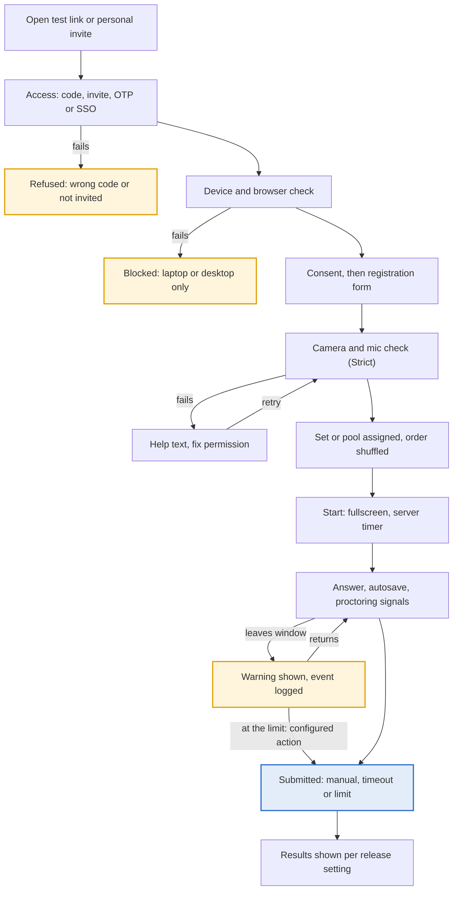
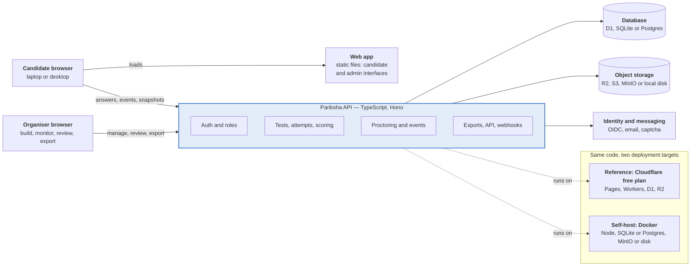
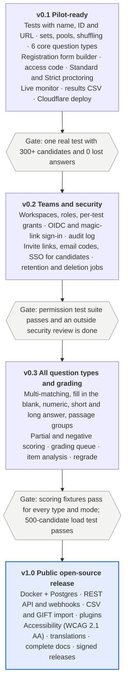

# PRD: Pariksha — open-source, self-hosted exam platform

| | |
| --- | --- |
| **Status** | Draft |
| **Last updated** | 2026-10-16 |
| **Author** | Satya K |
| **Product** | Pariksha — పరీక్ష · परीक्षा, "examination" |

## Contents

1. [Overview](#overview)
2. [Roles and permissions](#roles-and-permissions)
3. [Core concepts](#core-concepts)
4. [Question types and scoring](#question-types-and-scoring)
5. [Creating and configuring tests](#creating-and-configuring-tests)
6. [Candidate experience](#candidate-experience)
7. [Proctoring and integrity](#proctoring-and-integrity)
8. [Results, review and export](#results-review-and-export)
9. [Authentication, authorization and privacy](#authentication-authorization-and-privacy)
10. [Architecture and deployment](#architecture-and-deployment)
11. [Data model, question format and API](#data-model-question-format-and-api)
12. [Non-functional requirements](#non-functional-requirements)
13. [Open-source project](#open-source-project)
14. [Acceptance criteria](#acceptance-criteria)
15. [Roadmap](#roadmap)
16. [Risks and open questions](#risks-and-open-questions)

## Overview

Pariksha is a free, open-source exam platform that any school, company or community can run on its own account at zero cost. One deployment hosts many tests. Each test has its own name, ID, URL, question sets, registration form, access rules and proctoring policy. Candidates take tests in a browser; organisers get scores and integrity reports as CSV.

**Problem.** Groups that run tests without invigilators (campus hiring, course exams, certifications, contests) have two choices today:

- Free form tools (Google Forms, Microsoft Forms) have no question pools, no camera, no tab-switch detection and weak access control.
- Assessment platforms (Mettl, HackerEarth, Testlify, Testportal) charge per candidate or per month and keep candidate data on their servers.

No maintained open-source app combines modern proctoring, rich question types and zero-cost hosting. Moodle comes closest, but it is heavy to run and needs Safe Exam Browser installed.

**Principles**

1. **Zero cost by default.** The reference deployment fits the free tiers of Cloudflare; a Docker image runs on any small server.
2. **Self-hosted and private.** Data stays in the organiser's own account. No telemetry, no third-party trackers, no vendor lock-in.
3. **Generic.** Nothing is tied to one subject, organisation or language. Branding, form fields, question types and policies are configuration.
4. **Secure by design.** Answer keys never reach the browser; every rule is enforced on the server.
5. **Open formats.** Questions and results go in and out as documented JSON and CSV.

**Goals for v1**

- Create, name, clone and archive any number of tests, each with a unique ID and URL.
- Support 12 question types, including matching, multi-matching and ordering, with configurable scoring.
- Draw questions per candidate from pools or fixed sets, with shuffling.
- Offer configurable proctoring: camera, fullscreen, tab-switch detection, device rules.
- Provide proper authentication and role-based access for organisers, and flexible access modes for candidates.
- Deploy in under 30 minutes with no paid service.

**Non-goals for v1**

- Live video streaming or human live proctoring.
- Coding questions with a code runner (later, through a plugin).
- Native mobile apps or lockdown browsers.
- AI that decides whether someone cheated. The app flags; humans decide.
- A hosted SaaS run by the project.

**Success metrics**

| Metric | Target |
| --- | --- |
| Time from clone to first live test | ≤ 30 minutes |
| Hosting cost for 500 candidates in one hour | $0 on the reference stack |
| Attempts finishing without a technical failure | ≥ 99% |
| Answers lost | 0 |
| Results available after a test closes | ≤ 1 minute |

## Roles and permissions

One installation can host several **workspaces**, for example a college's placement cell and a company's hiring team. Each workspace has its own members, tests and data. Roles are given per workspace, except Instance owner.

| Role | Typical person | Purpose |
| --- | --- | --- |
| Instance owner | Whoever deployed the app | Creates workspaces, sets instance-wide security and retention limits |
| Workspace owner | Head of the team running tests | Manages members, settings and branding; can delete data |
| Admin | Test coordinator | Creates and publishes tests, manages candidates and access |
| Author | Subject expert | Writes questions and builds tests; cannot publish or see candidate data |
| Proctor | Person watching on test day | Live monitor, extends time, unlocks attempts |
| Reviewer | Grader or hiring panel | Reviews integrity flags, grades manual questions, sets verdicts |
| Viewer | Stakeholder | Reads results and exports; no edits |
| Candidate | Test taker | Registers, takes assigned tests, sees results if released |

**Permission matrix** (Y = allowed)

| Action | Owner | Admin | Author | Proctor | Reviewer | Viewer |
| --- | --- | --- | --- | --- | --- | --- |
| Manage members and roles | Y |  |  |  |  |  |
| Workspace settings, branding, retention | Y |  |  |  |  |  |
| Create, edit, clone tests | Y | Y | Y |  |  |  |
| Edit question banks | Y | Y | Y |  |  |  |
| Publish, open, close, archive tests | Y | Y |  |  |  |  |
| Manage candidate lists and invites | Y | Y |  |  |  |  |
| Live monitor, extend time, unlock | Y | Y |  | Y |  |  |
| See candidate personal data | Y | Y |  | Y | Y | Y |
| See snapshots and event logs | Y | Y |  | Y | Y |  |
| Grade and set verdicts | Y | Y |  |  | Y |  |
| Export results | Y | Y |  |  | Y | Y |
| Delete candidate data | Y |  |  |  |  |  |
| Create API keys and webhooks | Y | Y |  |  |  |  |

- Permissions can be narrowed to specific tests (for example, a Reviewer on two tests only).
- Every permission check runs on the server for every request; the interface only hides what a role cannot do.

## Core concepts



*High-resolution image: [`core-concepts.png`](architecture-diagrams/core-concepts.png) · Mermaid source: [`core-concepts.mmd`](architecture-diagrams/core-concepts.mmd)*

A workspace owns its members, question banks and tests. A test is published as numbered versions. Each version's sections draw questions from the banks. Every candidate's attempt is locked to the version it started on, so later edits never change a test that is already running.

## Question types and scoring

v1 ships 12 question types. Every type supports rich text (Markdown), code blocks with syntax highlighting, LaTeX maths, images, per-question points, difficulty, tags and an explanation shown only in review.

| Type | Candidate sees | Answer key | Auto-graded |
| --- | --- | --- | --- |
| Single choice | Radio buttons | One option | Yes |
| Multiple choice (select all) | Checkboxes | Set of options | Yes |
| Select exactly K | Checkboxes, locked after K picks | Set of K options | Yes |
| True / false | Two buttons | true or false | Yes |
| Assertion–reason | Assertion, reason, 4 fixed options | One option | Yes |
| Matching (one-to-one) | Dropdown or drag per left item | Map left → right, each right used once | Yes |
| Multi-matching (one-to-many) | Grid of checkboxes, left rows × right columns | Set of pairs | Yes |
| Ordering | Drag to reorder | Correct sequence | Yes |
| Fill in the blank | Text boxes inline in the text | Accepted answers per blank: exact, case-insensitive or regex | Yes |
| Numeric | Number box | Value with tolerance (± absolute or %) | Yes |
| Short answer | Text box (≤ 500 characters) | Optional model answer | Manual |
| Long answer | Text area (≤ 5,000 characters) | Rubric | Manual |

A **passage group** (one reading passage, table or code sample followed by several questions) can wrap any of these types.

**Scoring modes** (set per test, overridable per question)

| Mode | Applies to | Rule |
| --- | --- | --- |
| All-or-nothing | Every auto-graded type | Full points only if the answer exactly matches the key |
| Partial credit | Multiple choice, select K, matching, multi-matching, fill in the blank | Points × (correct parts − wrong parts) ÷ total parts, never below 0 |
| Negative marking | Any auto-graded type | Wrong answer loses a set fraction of the points (for example 0.25); blank loses nothing |
| Ordering by position | Ordering | Points × items in the right position ÷ items |
| Rubric | Short and long answer | Reviewer picks rubric levels; points summed |

- Scores are kept per question, per section and in total, plus percentage, rank and pass / fail against an optional pass mark.
- Changing a key after attempts exist offers **Regrade**, which recomputes every attempt and records an audit entry.
- Options can be pinned so they are never shuffled (for example "All of the above").

## Creating and configuring tests

A workspace can hold any number of tests. Each is created from scratch, from a template, by cloning, or by importing a JSON file. All settings below are per test. IDs below are referenced by the acceptance criteria.

### Identity and URLs

- **T-01** Each test has a display name (≤ 120 characters), an optional description, an immutable ID (`tst_` + 12 random characters) and a URL slug (lowercase letters, digits and hyphens, unique per workspace, editable until first publish).
- **T-02** The candidate URL is `https://<host>/<workspace-slug>/<test-slug>`. A short link `https://<host>/t/<6-char code>` and a QR code are generated for each test.
- **T-03** Tests can be tagged (for example *hiring*, *semester-2*) and filtered, searched and sorted in the test list.

### Lifecycle

- **T-04** States: **Draft** → **Scheduled** → **Open** → **Closed** → **Archived**.
  - Only Draft tests can be edited freely.
  - Publishing freezes a numbered version; later edits create a new draft version.
  - Attempts always keep the version they started on.
- **T-05** Clone copies settings, sections and question references into a new Draft with a new ID and slug.
- **T-06** A test can be exported as one JSON file (settings + questions) and imported into any Pariksha installation.

### Content and question selection

- **T-07** A test has one or more sections, each with a title, instructions, an optional time limit and its own question source.
- **T-08** Question sources:
  - **Fixed** — a hand-picked list
  - **Random from pool** — "N questions from bank B with tags X and difficulty Y", repeatable within a section
  - **Sets (forms)** — several fixed papers (Set A, B, C…) with one set given to each candidate
- **T-09** How sets are assigned: round-robin by registration order (default; neighbours get different sets), random, by a hash of the candidate ID, or by a column in an uploaded candidate list.
- **T-10** Shuffle options: shuffle questions within a section and shuffle answer options (except pinned ones). The order is stored per attempt, so it survives a refresh.
- **T-11** Before publishing, the builder warns if a pool has fewer questions than requested, or if sets differ in total points by more than a set amount.

### Timing and navigation

- **T-12** Availability window (opens at, closes at, time zone), overall duration, optional per-section durations, and a latest start time.
- **T-13** Navigation: free (jump anywhere), linear (no going back), or per section (free within a section, sections locked once left).
- **T-14** Attempts allowed (default 1), cooldown between attempts, and which attempt counts (highest, latest or average).
- **T-15** Grace for late sync (default 30 s) after the deadline; nothing is accepted after it.

### Registration form builder

- **T-16** Each test has a form that candidates fill in before starting. Field types:
  - short text, long text, email, phone (with country code), number, date
  - dropdown, radio, checkbox
  - URL with allowed domains
  - consent checkbox with linked text
- **T-17** Each field has a label, help text, required flag, validation (min / max, regex, allowed domains) and a "unique per test" flag used to block repeat registrations (for example email, phone or roll number).
- **T-18** Built-in templates: *Campus hiring* (name, email, phone, college, roll number, degree, graduation year, CGPA, resume link, LinkedIn, GitHub), *Course exam* (name, student ID, email), *Open contest* (name, email, country).
- **T-19** URL fields can check that the link opens (HTTP 200) and flag it as unverified if not.

### Access and results

- **T-20** Access modes (one per test; see Authentication):
  - public link + access code
  - invite-only list (each candidate gets a personal link)
  - email one-time code
  - single sign-on with allowed email domains
- **T-21** Optional allowlists: email domains, IP ranges (for example a lab's network), candidate list (only listed IDs may register).
- **T-22** Result release: never, immediately after submit, or on a set date. Choose what is shown: score only, score + section breakdown, or full review with correct answers and explanations.
- **T-23** Branding per workspace (logo, primary colour, footer text) and an optional custom message on the start and finish pages.
- **T-24** Interface language per test (English in v1, with translation files for others).

## Candidate experience



*High-resolution image: [`candidate-journey.png`](architecture-diagrams/candidate-journey.png) · Mermaid source: [`candidate-journey.mmd`](architecture-diagrams/candidate-journey.mmd)*

Which checks run depends on the test's proctoring profile. With Off, the device, camera and fullscreen steps are skipped.

- **C-01 Landing page.** Shows workspace branding, test name, duration, question count, sections, rules, proctoring level, supported devices and the availability window. A "Check my device" button runs the device, browser and camera checks at any time before the window opens.
- **C-02 Access.** Follows the test's access mode (T-20; see Candidate access). Errors say what to do next, for example "This invite link was already used. Contact the organiser."
- **C-03 Registration.** The test's form (T-16) is filled in after consent. Values are checked on the server, and a repeat of a unique field is refused.
- **C-04 Test screen.**
  - question panel and a palette of numbered questions (answered, not answered, marked for review)
  - Previous, Next, Mark for review, Clear answer
  - overall and section countdowns
  - font-size and high-contrast controls
  - optional on-screen calculator, set per test
- **C-05 Saving.** Each change is saved within 2 seconds. Offline changes are queued in the browser and synced on reconnect, with a banner showing Saving, Saved or Offline.
- **C-06 Resume.** After a crash or refresh, the same browser resumes the attempt with the clock still running. A different device needs a proctor unlock.
- **C-07 Time.** Warnings at 10 and 2 minutes (configurable). Sections auto-advance when their time ends. The whole attempt auto-submits at zero.
- **C-08 Submit.** A confirmation shows unanswered and marked counts. The finish page shows a receipt (attempt reference and time) and nothing about the score unless the release setting allows it.
- **C-09 Results.** When released, the candidate signs in with the attempt reference plus their email or a one-time code, and sees what the release setting allows (T-22).
- **C-10 Messages.** Proctors can broadcast a message (for example "5 more minutes added") that appears as a banner on candidates' screens.

## Proctoring and integrity

Each test picks a proctoring profile — Off, Standard or Strict — and can then adjust any control. Browser checks discourage cheating and leave a log; they cannot prove or stop it (a second phone is invisible to them). So the app flags attempts for human review and never disqualifies anyone automatically, except when a violation limit set by the organiser is reached.

| Control | Off | Standard | Strict |
| --- | --- | --- | --- |
| Desktop or laptop only (no phones or tablets) |  | Y | Y |
| Minimum window width 1024 px |  | Y | Y |
| Fullscreen required |  | Y | Y |
| Tab / window-switch warning and log |  | Y | Y |
| Copy, paste, right-click, print blocked |  | Y | Y |
| Watermark with candidate name and ID |  | Y | Y |
| Single active session per attempt | Y | Y | Y |
| Camera required for whole attempt |  |  | Y |
| Identity photo at start |  |  | Y |
| Snapshot every N seconds and on each violation |  |  | Y (60 s) |
| Microphone check and loudness events |  |  | Y |
| Face check (none or several faces) |  |  | Y |
| Extra-monitor check |  |  | Y |
| Auto-submit at violation limit |  |  | Y (5) |

### Behaviour

- **P-01 Device rule.** Phones and tablets are blocked using Client Hints (`Sec-CH-UA-Mobile`), user agent, touch points (to catch iPads that send a desktop user agent) and viewport width. The candidate sees: "This test needs a laptop or desktop computer."
- **P-02 Browsers.** Supported: latest 2 versions of Chrome, Edge and Firefox on desktop; Safari on macOS where fullscreen and camera checks pass. Other browsers get a block message listing the supported ones.
- **P-03 Fullscreen.** The test starts only from a click that enters fullscreen. On exit, an overlay hides the questions until fullscreen is restored; the timer keeps running.
- **P-04 Leaving the window.** `visibilitychange` and window `blur` record when the candidate left and how long they were away. On return, a modal shows "Leaving the test window is not allowed. Warning 2 of 5."
- **P-05 Camera.** In Strict, the attempt cannot start without camera permission and a live frame. If the camera stops, is unplugged or goes black during the test, an overlay blocks the questions until it is back, and the outage is logged.
- **P-06 Snapshots.** 320×240 JPEG (about 25 KB) at the set interval and on each violation, uploaded to private storage. No video and no audio is ever recorded or stored.
- **P-07 Face check.** An on-device model (MediaPipe) counts faces in each snapshot and flags none or several. No face data or biometric templates are stored.
- **P-08 Extra monitors.** Where the browser exposes it (Window Management API in Chromium), a second screen is detected and logged.
- **P-09 Violation limit.** Configurable count (default 5) and action: warn only, auto-submit, or lock the attempt pending proctor review.
- **P-10 Integrity flag.** Each attempt gets `clean`, `review` or `high_risk` from a rule the organiser can edit (defaults: `high_risk` at the violation limit, camera lost > 120 s, or several faces in ≥ 2 snapshots; `review` on any violation).

## Results, review and export

### Live monitor

- **R-01** While a test is open, a live table refreshes every 15 s. It shows counts (registered, in check, in progress, submitted, auto-submitted). Per candidate it shows set, time left, answered count, violations, last heartbeat and camera status.
- **R-02** Filters: flagged only, inactive more than 2 minutes, by set. Proctor actions: extend time, unlock on a new device, reset an attempt, force submit, send a message to a candidate's screen. Every action is audit-logged.

### Review and grading

- **R-03** A per-attempt page shows registration data, identity photo, snapshot timeline (flagged in red), event log, each answer against the key, and score by section.
- **R-04** A grading queue holds manual questions. Grading can be blind (candidate identity hidden) and by question across all candidates.
- **R-05** Reviewers set a verdict (Clear, Suspicious, Disqualified) with a note. The verdict appears in exports.

### Analytics

- **R-06** Test summary:
  - score distribution
  - mean, median and pass rate
  - completion rate
  - average time
  - integrity-flag counts
  - per-set comparison, to check sets were equally hard
- **R-07** Item analysis for each question:
  - share answered correctly (difficulty)
  - discrimination index (top 27% vs bottom 27%)
  - option pick rates, to find bad distractors
  - average time spent

### Export

- **R-08** Results CSV, one row per candidate:
  - every registration-form field, using the field labels as column names
  - set, start and submit times, time taken, submit reason
  - total score, maximum score, percent, rank, pass / fail
  - one column per section score
  - integrity counts and flag, reviewer verdict and note
  - a link to the review page
- **R-09** Detailed exports:
  - per-answer CSV (attempt, question ID, response, correct, points, time on question)
  - events CSV
  - full JSON export of the test
  - a ZIP of snapshots for selected candidates
- **R-10** CSV files are UTF-8 with BOM (so they open in Excel with any script), named `<test-slug>_results_<YYYYMMDD-HHMM>.csv`, and available during the test for partial results.
- **R-11** A webhook `attempt.submitted` and an API endpoint let other systems (an ATS, a learning platform, Google Sheets via Apps Script) pull results automatically.

## Authentication, authorization and privacy

### Organiser sign-in

- **S-01** Sign-in methods, each enabled by the instance owner:
  - **Single sign-on (OIDC):** Google, Microsoft, GitHub or any OIDC provider.
  - **Email magic link:** needs an email-sending service; most have a free tier.
  - **Email and password:** Argon2id hashing, Docker deployments only. On the Cloudflare free plan a Worker gets 10 ms of CPU per request, too little for safe password hashing, so this method is off there.
- **S-02** Optional TOTP two-factor for password accounts; the instance owner can require 2FA or SSO for Owner and Admin roles.
- **S-03** Sessions: HttpOnly, Secure, SameSite=Lax cookies; 12-hour idle timeout; rotated on sign-in and role change; "sign out everywhere".
- **S-04** Members join by invitation link (expires in 7 days) or by automatic join for an allowed email domain.
- **S-05** API keys are scoped to one workspace and a set of permissions, shown once, stored hashed, and revocable. **Revoking or demoting the member who created a key does not revoke that key** — a key is an independent credential once minted, not tied to its creator's current role, so an organiser offboarding someone must revoke that person's keys explicitly (Phase 8d-2 whole-branch review, MAJOR-3: tracked as a follow-up to add `created_by` and revoke-on-demotion; not done on that branch to avoid a migration landing out of order against Phase 7e's in-flight `0010`/`0011`).

### Candidate access (per test)

| Mode | How the candidate gets in | Best for |
| --- | --- | --- |
| Link + access code | Public URL; the code is announced in the room | Campus drives, lab exams |
| Invite-only links | Personal signed link per candidate, single use, from an uploaded list | Known candidate lists |
| Email one-time code | 6-digit code to the email entered; 10-minute expiry | Remote, open registration |
| SSO with domain rule | Sign in with the candidate's school or company account | Universities, internal certifications |

- **S-06** Each attempt gets a random 256-bit token; only its hash is stored. Every request is checked against the token, the attempt status and the server deadline.
- **S-07** *(partly met — see [ADR 0009](adr/0009-same-origin-proof-of-work-instead-of-a-hosted-captcha.md))* Registration is protected by bot protection **and** by rate limits per attempt and per test. Limits are not per IP, because a whole campus often shares one IP. The rate limits ship in full. The bot protection shipped is a **same-origin proof of work**, not a hosted captcha: a Turnstile or hCaptcha widget needs third-party `script-src`, `frame-src` and `connect-src` entries in a CSP that `S-11` keeps at `'self'`, so it is a per-instance opt-in (`CAPTCHA_SECRET`, `CAPTCHA_VERIFY_URL`, and `access.captcha` per test) rather than the default. An instance that turns it on no longer satisfies `S-11`.

### Authorization

- **S-08** Role-based access per workspace (see Roles and permissions), with optional per-test grants.
- **S-09** Tenant isolation: every query is scoped by workspace ID in the data layer, with automated tests that try to read across workspaces.
- **S-10** Answer keys, explanations and other candidates' data never reach a candidate's browser.

### Privacy

- **S-11** Collect only what the test's form asks for. No analytics, telemetry or third-party scripts; fonts and the face model are served from the app itself.
- **S-12** A consent screen, with text the organiser can edit, says what is collected, why, who sees it and for how long. The consent text version and time are stored per candidate.
- **S-13** Retention per test (defaults: snapshots 90 days, personal data and answers 12 months). A daily job deletes expired data; deletions are logged.
- **S-14** Candidate rights: Owners can export or delete one candidate's data on request. Deletion removes registration data, answers, events and snapshots, and leaves an anonymised score row if the organiser chooses.
- **S-15** Optional field-level encryption (AES-GCM) for personal fields, with the key held as a deployment secret.
- **S-16** Snapshots live in a private bucket and open only through signed URLs that expire in 10 minutes.
- **S-17** Data location: the organiser picks the database region and storage jurisdiction where the host allows it (for example Cloudflare R2's EU jurisdiction).
- **S-18** An audit log records sign-ins, role changes, test publishes, key changes, regrades, exports and deletions, with who, what and when. It is append-only and kept for 12 months.
- **S-19** Documentation includes a data-processing template that helps organisers meet GDPR and India's DPDP Act 2023.

## Architecture and deployment



*High-resolution image: [`architecture.png`](architecture-diagrams/architecture.png) · Mermaid source: [`architecture.mmd`](architecture-diagrams/architecture.mmd)*

The API and scoring logic are plain TypeScript written against three adapter interfaces: database, object storage and identity. The same code therefore runs on Cloudflare's free plan or in a Docker container.

| Component | Cloudflare reference (zero cost) | Docker self-host |
| --- | --- | --- |
| Web app | Cloudflare Pages | Served by the API container (or any static host) |
| API | Workers (Hono) | Node 22 (Hono) |
| Database | D1 (SQLite) | SQLite for small installs, Postgres 16 for large |
| Snapshots and files | R2, private bucket, signed URLs | MinIO / any S3, or local disk |
| Organiser sign-in | OIDC; magic link via a free email tier; optional Cloudflare Access in front of admin routes | OIDC, magic link (SMTP), or password with Argon2id + TOTP |
| Bot protection | Same-origin proof of work (default; see [ADR 0009](adr/0009-same-origin-proof-of-work-instead-of-a-hosted-captcha.md)). Turnstile or hCaptcha is a per-instance opt-in that also needs three CSP directives added locally | Same-origin proof of work (default); hCaptcha or Turnstile as an opt-in, same terms |
| Scheduled jobs (retention, webhook retries) | Cron Triggers | Built-in scheduler |
| HTTPS | Automatic | Caddy reverse proxy with automatic certificates |

**Frontend.** React + Vite + TypeScript. The candidate bundle is split from the admin bundle so candidates download as little as possible. Face detection uses MediaPipe in the browser, loaded only for Strict tests.

**Deploy steps (reference)**

1. Fork the repo, or click "Deploy to Cloudflare".
2. The setup script creates the D1 database and R2 bucket and runs migrations.
3. Set secrets: OIDC client ID and secret, session key, optional email API key and field-encryption key.
4. Open the URL; the first-run wizard creates the instance owner and first workspace.
5. Optionally add a custom domain in Cloudflare.

The Docker path is the same, with `docker compose up` and an `.env` file in place of steps 1–3.

## Data model, question format and API

### Main entities

| Entity | Key fields |
| --- | --- |
| workspace | id, slug, name, branding\_json, settings\_json |
| user / membership | user id, email, auth provider; membership = workspace\_id, role, test grants |
| question\_bank | id, workspace\_id, name, tags |
| question | id, bank\_id, type, prompt\_md, media, options\_json, key\_json, scoring\_json, points, difficulty, tags, explanation\_md, version |
| test | id (`tst_…`), workspace\_id, slug, name, status, current\_version |
| test\_version | test\_id, version, settings\_json (timing, access, proctoring, release, form), sections\_json, published\_at |
| set | test\_version, set\_no, ordered question ids |
| candidate | id, test\_id, form\_values\_json (encrypted fields where configured), consent\_version, created\_at |
| attempt | id, candidate\_id, test\_version, set\_no, layout\_json (question and option order), started\_at, deadline\_at, submitted\_at, submit\_reason, score\_json, flag, token\_hash |
| response | attempt\_id, question\_id, value\_json, saved\_at, client\_seq, points, graded\_by |
| event | attempt\_id, type, detail\_json, client\_ts, server\_ts |
| snapshot | attempt\_id, storage\_key, taken\_at, reason, face\_count (identity, violation and flagged only; interval snapshots are listed from storage) |
| review | attempt\_id, reviewer, verdict, note |
| audit\_log | actor, action, target, detail\_json, at |
| api\_key / webhook | workspace\_id, scopes, hashed secret / url, events, signing secret |

### Open question format

Questions use a documented, versioned JSON format (`pariksha/question@1`), checked against the JSON Schema in [`schemas/question-1.json`](../schemas/question-1.json) on import (full spec: [question-format.md](question-format.md)). A whole test — timing, access, registration form, sections, scoring and release — is a second format, `pariksha/test@1` ([test-format.md](test-format.md), [`schemas/test-1.json`](../schemas/test-1.json)), so a test exported from one installation imports into any other. A worked example of both, with the registration form and results CSV, is in [`examples/reasoning-aptitude/`](../examples/reasoning-aptitude/). Example question:

```json
{
  "$schema": "../schemas/question-1.json",
  "id": "SQL-09",
  "type": "matching",
  "prompt": "Match each operation to its result.",
  "left": ["INNER JOIN", "LEFT JOIN", "UNION", "UNION ALL"],
  "right": ["Only matching rows", "All left rows plus matches", "Combine and remove duplicates", "Combine and keep duplicates"],
  "key": {"INNER JOIN": "Only matching rows", "LEFT JOIN": "All left rows plus matches", "UNION": "Combine and remove duplicates", "UNION ALL": "Combine and keep duplicates"},
  "scoring": {"mode": "partial", "points": 2},
  "difficulty": "easy",
  "tags": ["sql", "joins"],
  "explanation": "Basic join and set semantics."
}
```

- **D-01** Import formats: Pariksha JSON (all types), CSV (single and multiple choice, true / false, numeric, fill in the blank), and Moodle GIFT. QTI 2.1 import comes after v1.
- **D-02** Import is all-or-nothing, with a line-by-line error report (duplicate IDs, keys not among the options, K not equal to the key count, missing fields).

### REST API (v1)

All endpoints are JSON over HTTPS, versioned under `/api/v1`, authenticated with session cookies (web app) or API keys (scripts).

| Area | Endpoints |
| --- | --- |
| Tests | `GET/POST /tests`, `GET/PATCH /tests/{id}`, `POST /tests/{id}/publish`, `/clone`, `/close`, `/archive`, `GET /tests/{id}/export` |
| Questions | `GET/POST /banks`, `GET/POST /banks/{id}/questions`, `POST /banks/{id}/import` |
| Candidates | `POST /tests/{id}/candidates/import`, `POST /tests/{id}/invites`, `GET /tests/{id}/candidates` |
| Attempts | `GET /tests/{id}/attempts`, `GET /attempts/{id}`, `POST /attempts/{id}/extend`, `/unlock`, `/reset`, `/submit` |
| Results | `GET /tests/{id}/results.csv`, `/responses.csv`, `/events.csv` |
| Candidate runtime | `POST /run/{test}/register`, `/start`, `PUT /run/attempt/answer`, `POST /run/attempt/events`, `/snapshot`, `/submit` (attempt token) |

- **D-03** Webhooks: `attempt.started`, `attempt.submitted`, `attempt.flagged`, `test.closed`. Each delivery is signed with HMAC-SHA256 and retried with backoff up to 24 hours.
- **D-04** An OpenAPI 3.1 description is published with every release.

## Non-functional requirements

| Area | Requirement |
| --- | --- |
| Capacity (free tier) | 500 candidates at once, all starting within 5 minutes; about 900 candidate-hours per day before daily limits |
| Capacity (scaled) | 5,000 at once on Cloudflare Workers Paid ($5/month) or Docker on 4 vCPU / 8 GB with Postgres |
| Latency | p95 API ≤ 300 ms; answer save confirmed ≤ 2 s; first load ≤ 3 s on 10 Mbps |
| Durability | 0 lost answers: client queue with retry + idempotent server upsert keyed by attempt, question and sequence number |
| Availability | Proctoring failures (snapshot upload, face model) never block answering. A test continues through short network drops of up to 10 minutes |
| Page weight | Candidate app ≤ 300 KB gzipped; face model ≤ 3 MB, loaded only when Strict proctoring is on |
| Browsers | Latest 2 versions of Chrome, Edge, Firefox; Safari 17+ on macOS. Admin app works on tablets too |
| Accessibility | WCAG 2.1 AA: keyboard-only use, screen-reader labels, contrast, zoom to 200%; extra time per candidate |
| Internationalisation | All interface text in translation files; right-to-left layout supported; dates in the test's time zone |
| Security baseline | OWASP ASVS level 2; strict Content-Security-Policy; dependency scanning and signed releases |
| Observability | Structured logs without personal data; health endpoint; per-test error and latency counters on the admin dashboard |
| Backups | Cloudflare: D1 point-in-time restore + a nightly export to R2. Docker: nightly database dump with documented restore |
| Testing | Unit tests for scoring of every question type; end-to-end tests (Playwright) for the candidate and admin flows; a k6 load-test script in the repo |

Free-tier budget for the reference deployment, per 500 candidates for one hour:

| Resource | Free limit | Use |
| --- | --- | --- |
| Worker requests | 100,000 / day | about 55,000 |
| D1 rows written | 100,000 / day | about 55,000 including indexes |
| D1 rows read | 5,000,000 / day | under 300,000 |
| R2 storage | 10 GB / month | about 0.75 GB of snapshots |
| R2 writes | 1,000,000 / month | about 30,000 |

Two **per-request** limits of the Workers free plan shape the API as much as the daily totals do:

| Per-request limit | Free plan | What it means for Pariksha |
| --- | --- | --- |
| CPU time per invocation | 10 ms | Enough for routing, validation, scoring and a query; **not** enough for Argon2id password hashing, so organiser sign-in on Cloudflare uses OIDC or magic links (S-01). Duration spent waiting on D1 or R2 is not CPU time and is not charged |
| Subrequests per invocation | 50 | Every D1, R2 and KV call counts as one. The hottest path — saving one answer — must stay at one D1 write plus at most one R2 call. No endpoint may loop over questions issuing a query each; batch or join instead. A Worker that needs more than 50 is a design error on the free plan, not a reason to leave it |

To stay inside the daily limits, the snapshot upload doubles as the 60 s heartbeat under Strict, the only profile whose default takes an interval snapshot at all; Standard's default proctoring takes none, so there is no upload there to double as one. Events are batched up to 10 per request. Each interval snapshot writes its own database row once the upload succeeds. Limits are from Cloudflare's [Workers limits](https://developers.cloudflare.com/workers/platform/limits/), [Workers pricing](https://developers.cloudflare.com/workers/platform/pricing/), [D1 pricing](https://developers.cloudflare.com/d1/platform/pricing/) and [R2 pricing](https://developers.cloudflare.com/r2/pricing/) pages.

## Open-source project

- **O-01 License.** GNU AGPL-3.0 (decided; see [ADR 0013](adr/0013-license-agpl-v3.md)): anyone may self-host, modify, or embed Pariksha, and the network-use clause ensures improvements to hosted services remain open. Documentation, JSON Schemas and the sample tests and question banks in `examples/` are CC BY 4.0. Contributions are inbound = outbound, with a Developer Certificate of Origin sign-off per commit and no CLA.
- **O-02 Repository.** One monorepo on GitHub:
  - `apps/web` — candidate and admin interfaces
  - `apps/api` — Hono API that runs on Workers and Node
  - `packages/core` — scoring, question types, policies; pure TypeScript, fully unit-tested
  - `packages/db` — Drizzle schema and migrations for D1, SQLite and Postgres
  - `packages/storage` — R2, S3 and local-disk adapters
  - `deploy/` — Cloudflare and Docker setups
  - `docs/` — this PRD, the question-format and test-format specs, architecture decision records (`docs/adr/`) and diagrams (`docs/architecture-diagrams/`)
  - `schemas/` — JSON Schemas for questions, banks and tests
  - `examples/` — complete worked tests, one folder per subject
- **O-03 Install paths.**
  - A "Deploy to Cloudflare" button
  - `docker compose up` with SQLite (small) or Postgres (large)
  - A first-run wizard: create the instance owner, the first workspace and a sample test
- **O-04 Docs.** Quick start (under 30 minutes), an organiser guide, a candidate FAQ the organiser can link to, an admin security guide, API reference, the question format spec, and a privacy template.
- **O-05 Quality gates.** Every pull request runs lint, type-check, unit and end-to-end tests. Releases follow semantic versioning with migration notes. Security issues are reported privately via `SECURITY.md`, with fixes released within 14 days.
- **O-06 Extensibility.** A plugin interface for new question types (renderer + scorer + JSON Schema), proctoring signals and export targets. A coding-question runner is the first planned plugin.
- **O-07 Community.** `CONTRIBUTING.md`, a code of conduct, issue templates, "good first issue" labels, and a public roadmap. No telemetry, so feedback comes through GitHub Discussions.

## Acceptance criteria

v1 is accepted when every item passes on both deployment targets (Cloudflare free plan and Docker + Postgres), tested in Chrome on Windows, Edge on Windows, Firefox on Linux and Chrome on macOS.

### Setup and tests

- [ ] **AC-01** (O-03) A new user deploys with the Cloudflare button or `docker compose up`, completes the wizard and opens a sample test in ≤ 30 minutes, using no paid service.
- [ ] **AC-02** (T-01, T-02) Creating three tests gives three unique `tst_` IDs. Each test's URL, short link and QR code open that test only. A duplicate slug in the same workspace is rejected.
- [ ] **AC-03** (T-04) Editing a published test creates a new draft version. Candidates who already started keep the old version. Publishing the draft affects new attempts only.
- [ ] **AC-04** (T-05, T-06) A cloned test and an exported-then-imported test (on another installation) produce identical questions, settings and scoring.
- [ ] **AC-05** (D-02) Importing a bank with one bad question (a key not among the options) imports nothing and reports the line and reason.

### Question types and scoring

- [ ] **AC-06** All 12 question types can be authored, previewed, answered and scored. For each type a fixture of correct, partly correct, wrong and blank answers gives the expected points under every scoring mode that applies.
- [ ] **AC-07** Select-exactly-K disables further choices after K picks. Multi-matching accepts several right items per left item. Ordering supports drag and keyboard reordering.
- [ ] **AC-08** Changing a key and running Regrade updates every affected attempt's score and writes one audit entry.

### Selection and shuffling

- [ ] **AC-09** (T-08, T-09) With 5 sets and round-robin, 50 consecutive registrations split 10 each, and no two consecutive registrations get the same set.
- [ ] **AC-10** (T-08) "10 from pool, tag sql, medium" gives each candidate 10 distinct questions matching the filter.
- [ ] **AC-11** (T-10) Two candidates on the same set see different question and option orders. Pinned options stay in place. A refresh keeps each order.

### Candidate flow

- [ ] **AC-12** (T-16, T-17) Required, regex, domain and unique rules on registration fields each block an invalid submission with a message on the field. A repeat of a unique field is refused.
- [ ] **AC-13** (T-12) The server timer ignores changes to the computer clock. Answers sent more than 30 s after the deadline are rejected.
- [ ] **AC-14** Turning the network off for 2 minutes mid-test loses no answers. Closing and reopening the browser resumes with the same questions, answers and remaining time.
- [ ] **AC-15** (T-13) In linear navigation a candidate cannot return to an earlier question, either through the interface or through the API.
- [ ] **AC-16** (T-22) Results show to candidates exactly as the release setting says, and never before it.

### Proctoring

- [ ] **AC-17** (P-01) With Standard or Strict, an Android phone, an iPhone and an iPad (desktop-mode Safari) are all blocked.
- [ ] **AC-18** (P-03, P-04) Leaving fullscreen, switching tabs and Alt/Cmd+Tab each show the warning with the correct count and create an event with its duration.
- [ ] **AC-19** (P-05) In Strict, denying the camera prevents starting. Unplugging it mid-test blocks the questions within 5 s until it is reconnected.
- [ ] **AC-20** (P-06) A 60-minute Strict attempt stores 55–65 interval snapshots plus one per violation. No audio or video file exists anywhere in storage.
- [ ] **AC-21** (P-09) Reaching the violation limit triggers the configured action (warn, auto-submit or lock).

### Security and privacy

- [ ] **AC-22** (S-10) No candidate API response contains keys, explanations or other candidates' data. This is checked by an automated test that scans every response.
- [x] **AC-23** (S-08, S-09) For every role in the permission matrix, each allowed action succeeds and each other action returns 403. A member of workspace A gets 404 for any workspace-B resource.
- [ ] **AC-24** (S-13) After the retention period, the daily job deletes snapshots and personal data for that test, and the audit log records it.
- [ ] **AC-25** (S-14) Deleting one candidate removes their data from the database and storage. Their score row stays only if anonymised.
- [ ] **AC-26** (S-16) A snapshot URL stops working after 10 minutes.

### Results and capacity

- [ ] **AC-27** (R-08, R-10) The results CSV has one row per candidate, a column for every form field and section score, opens correctly in Excel with non-Latin names, and matches hand-scored totals for 10 sample attempts.
- [ ] **AC-28** (R-11, D-03) `attempt.submitted` reaches a test endpoint with a valid HMAC signature within 10 s, and is retried if the endpoint returns 500.
- [ ] **AC-29** (Capacity) A k6 run of 500 candidates (all start within 5 minutes, 40 answers each, Strict proctoring) on the Cloudflare free plan ends with < 0.5% errors, p95 ≤ 300 ms, and usage under the daily limits.

## Roadmap



*High-resolution image: [`roadmap.png`](architecture-diagrams/roadmap.png) · Mermaid source: [`roadmap.mmd`](architecture-diagrams/roadmap.mmd)*

v0.1 contains exactly what a first real unproctored test needs, so it can be used in production early. Each later release starts only after the gate above it is passed. Dates are not set yet; they depend on team size (see Open questions).

## Risks and open questions

| Risk | Impact | Mitigation |
| --- | --- | --- |
| Browser proctoring is beaten by a second device | Inflated scores | State it plainly in docs; flags plus human review; recommend a supervised follow-up round for high-stakes use |
| Free-tier limits change | Zero-cost promise breaks | Storage and database adapters; Docker path; budget check in the admin dashboard warns at 70% of daily limits |
| Whole campus behind one IP | Legitimate users rate-limited | Limits per attempt and per test, not per IP; load test from a single IP |
| Camera and face checks fail in poor light or on old webcams | False flags | Flags never auto-reject; organiser-tunable thresholds; identity photo for comparison |
| Privacy misuse by an organiser | Harm to candidates | Retention defaults, consent screen, audit log, no audio or video recording by design |
| Two databases (D1 and Postgres) drift | Bugs on one target | One Drizzle schema; CI runs the full test suite on both |
| Small maintainer team | Slow fixes | Narrow v1 scope, plugin interface, clear contribution guide |

### Open questions

- [ ] Name check for "Pariksha": confirm there are no trademark, GitHub-organisation or domain conflicts before the public launch.
- [ ] Should email one-time codes ship in v1, given they need an outside email service?
- [ ] Is Firefox support for Strict proctoring a must for v1, or Chromium-only at first?
- [ ] Should candidates be able to request a copy of their own data from the candidate app, or only through the organiser?
- [ ] Who maintains the project long-term (Dhan, a foundation, or community maintainers)?
- [ ] Target dates for v0.1 and the team size behind them.
