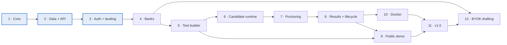

# Pariksha build roadmap

| | |
| --- | --- |
| **Status** | Active |
| **Last updated** | 2026-10-27 |
| **Implements** | [PRD.md](PRD.md) |
| **Design system** | [DESIGN.md](../DESIGN.md) |

The [PRD roadmap](PRD.md#roadmap) sets four *product* milestones — v0.1 pilot-ready, v0.2 teams and security, v0.3 all question types and grading, v1.0 public release. This document is the *build* order underneath them: twelve phases, each one shipping working, testable software, with the gate that has to pass before the next phase starts — plus **Phase 6.5**, a design pass inserted between 6 and 7 that ships no new capability. It is a deviation from the original twelve and is recorded as one under [decisions that extend the PRD](#decisions-that-extend-the-prd).

Read this with the PRD. Where the two disagree, the PRD wins on *what* and this file wins on *when*.

## Contents

1. [Progress](#progress)
2. [Phases](#phases)
3. [Gates](#gates)
4. [Dependency order](#dependency-order)
5. [Decisions that extend the PRD](#decisions-that-extend-the-prd)
6. [Mapping to PRD milestones](#mapping-to-prd-milestones)
7. [Plan documents](#plan-documents)
8. [What is needed from the operator](#what-is-needed-from-the-operator)

## Progress

Where the build actually stands. Update this table when a phase's state changes; the
per-phase sections below describe the *plan*, this table describes the *state*.

| Phase | State | Landed | Next |
| --- | --- | --- | --- |
| 1 — Foundation and scoring core | **Done** | `packages/core`: all 12 question types, all 5 scoring modes, seeded shuffling, pool draws, set assignment, import rules. Monorepo, CI, 173 tests. Merged as [#134](https://github.com/SriSatyaLokesh/pariksha/pull/134) | Four small items deferred from its review: [#130](https://github.com/SriSatyaLokesh/pariksha/issues/130)–[#133](https://github.com/SriSatyaLokesh/pariksha/issues/133) |
| 2 — Data and API platform | **Done** | `packages/db` (Drizzle schema and migrations for D1, SQLite and Postgres), `packages/storage` (R2, S3 and local-disk adapters) and `apps/api` (Hono application, Workers and Node entries, the subrequest-budget guard). Merged as [#138](https://github.com/SriSatyaLokesh/pariksha/pull/138) | Deployment itself (Cloudflare worker, D1 and R2, an idempotent setup script, [#162](https://github.com/SriSatyaLokesh/pariksha/issues/162)–[#164](https://github.com/SriSatyaLokesh/pariksha/issues/164)) landed with Phase 3's deploy work below |
| 3 — Organiser auth, roles, first run and landing page | **Done** | Design tokens, the web shell, design-system components and the landing page ([#136](https://github.com/SriSatyaLokesh/pariksha/pull/136)); the permission matrix, sessions, memberships and the audit log ([#145](https://github.com/SriSatyaLokesh/pariksha/pull/145), [#155](https://github.com/SriSatyaLokesh/pariksha/issues/155)); OIDC and magic-link sign-in ([#153](https://github.com/SriSatyaLokesh/pariksha/issues/153)); the first-run wizard, end to end ([#157](https://github.com/SriSatyaLokesh/pariksha/issues/157), [#158](https://github.com/SriSatyaLokesh/pariksha/issues/158)); and a deployed Cloudflare Worker, D1 database and R2 bucket behind an idempotent setup script ([#163](https://github.com/SriSatyaLokesh/pariksha/issues/163)) | The setup script is merged but has not yet run against a live account: the deploy token is missing the D1 and R2 grants `setup.mjs` needs ([#164](https://github.com/SriSatyaLokesh/pariksha/issues/164), [what is needed from the operator](#what-is-needed-from-the-operator)) |
| 4 — Question banks and authoring | **Done** | Bank CRUD and the bank browser; an editor with live preview for all 12 question types; passage groups ([#50](https://github.com/SriSatyaLokesh/pariksha/issues/50)); whole-bank import — Pariksha JSON, CSV and Moodle GIFT, all-or-nothing with a line-by-line report ([#51](https://github.com/SriSatyaLokesh/pariksha/issues/51), [#52](https://github.com/SriSatyaLokesh/pariksha/issues/52)); and whole-bank/single-question JSON export (JSON only — CSV/GIFT export was not built), round-tripped against import field for field across all 12 types ([#53](https://github.com/SriSatyaLokesh/pariksha/issues/53)) — `apps/api/test/export/round-trip.test.ts` is the proof, checked as set equality rather than array order | `AC-05` is met, with two caveats this row keeps rather than only the task report: **(1)** bank-level question order is not preserved by storage (a pre-existing property of `listQuestions`/`writeImportedBank`, not changed by this task) — the round-trip test accordingly proves every question round-trips with no loss, not that the exported array's order matches the order a document declared its questions in; **(2)** `AC-07`'s keyboard reordering shipped in full but its drag-and-drop half is deferred (buttons-first — see the Phase 4 plan's "Known deferrals"). This phase's work is complete on `phase-4/bank-crud-and-browser` but **has not merged to `main` yet** — unlike every other Done row above, there is no PR number to cite here. Phase 5, the test builder, can start once it does |
| 5 — Test builder and lifecycle | **Done** | Tests with a `tst_` ID, slug, short link and inline-SVG QR code, and the one public unguarded route `GET /t/:code` ([#54](https://github.com/SriSatyaLokesh/pariksha/issues/54)); sections drawing from fixed lists, random pools and sets, with the live draw and points balance the builder shows ([#55](https://github.com/SriSatyaLokesh/pariksha/issues/55), [#56](https://github.com/SriSatyaLokesh/pariksha/issues/56)); the registration form builder across all eleven field types with T-19's server-side reachability check ([#57](https://github.com/SriSatyaLokesh/pariksha/issues/57), [#58](https://github.com/SriSatyaLokesh/pariksha/issues/58)); timing, navigation and attempt policy ([#59](https://github.com/SriSatyaLokesh/pariksha/issues/59)); access modes, allowlists and candidate-list ingest ([#60](https://github.com/SriSatyaLokesh/pariksha/issues/60)); result release and branding with the contrast gate ([#61](https://github.com/SriSatyaLokesh/pariksha/issues/61)); the Draft → Scheduled → Open → Closed → Archived lifecycle with numbered frozen versions, where publishing stamps the draft head and opens N+1 ([#62](https://github.com/SriSatyaLokesh/pariksha/issues/62)); clone, whole-test export and all-or-nothing import ([#63](https://github.com/SriSatyaLokesh/pariksha/issues/63)); and one publish checklist — `GET …/checklist` and `POST …/publish` compute the same rows from the same function, blocking and advisory ([#64](https://github.com/SriSatyaLokesh/pariksha/issues/64)). ADR 0007 records the review-comment model ([#148](https://github.com/SriSatyaLokesh/pariksha/issues/148)) | `AC-02`, `AC-03`, `AC-04`, `AC-09`, `AC-10` and `AC-11` are met — `AC-11`'s "a refresh keeps each order" waits for Phase 6, which owns attempts. Deferred, and recorded in the phase plan's own "Known deferrals" so they are not rediscovered as bugs: the reviewers panel, per-question comments and approvals (only `review_requested` and the "In review" badge ship, so `UX-10` is partly met); the phone field's country picker (the dialling code ships, the `<select>` does not); pointer drag for reordering, as in Phase 4; invite links, which Phase 6 mints against the list this phase ingests; and editors for `consent`, `proctoring` and `retention`, which belong to Phases 6, 7 and 8 and ride through import, clone and export untouched |
| 6 — Candidate runtime | **Done** | The candidate landing page and all four access modes ([#65](https://github.com/SriSatyaLokesh/pariksha/issues/65), [#66](https://github.com/SriSatyaLokesh/pariksha/issues/66)); invite minting, consent and server-side registration ([#67](https://github.com/SriSatyaLokesh/pariksha/issues/67)); the same-origin proof of work that stands in for a CAPTCHA, and the rate limiter behind it ([#68](https://github.com/SriSatyaLokesh/pariksha/issues/68)); attempt creation with a pinned version, layout and scrubbed paper ([#69](https://github.com/SriSatyaLokesh/pariksha/issues/69)); the runner, all twelve answer blocks and the candidate media route ([#70](https://github.com/SriSatyaLokesh/pariksha/issues/70), [#71](https://github.com/SriSatyaLokesh/pariksha/issues/71)); the offline save queue and the idempotent server upsert ([#72](https://github.com/SriSatyaLokesh/pariksha/issues/72)); the server-authoritative clock and the three navigation modes ([#73](https://github.com/SriSatyaLokesh/pariksha/issues/73), [#74](https://github.com/SriSatyaLokesh/pariksha/issues/74)); submission, automatic scoring, the receipt and the release gate — including `C-09`'s emailed result code ([#75](https://github.com/SriSatyaLokesh/pariksha/issues/75)); and Task 12, candidate response scrubbing (`AC-22`, [#76](https://github.com/SriSatyaLokesh/pariksha/issues/76)) — `apps/api/test/run/scrub-scan.test.ts` replays a sentinel fixture across every endpoint `ROUTE_AUTH` marks `attempt`, `entry` or candidate-`public`, derived mechanically from that table rather than hand-written, and confirms `forCandidate` and `releasedResult` (built in Task 5 and Task 11) are already complete field-by-field allowlists — no key, explanation, rubric, model answer, accepted pattern or another candidate's data rides any candidate response in any state, and `full_review` carries them only once genuinely released. **[#129](https://github.com/SriSatyaLokesh/pariksha/issues/129) closed here rather than in Phase 1**: it asked for a server-side execution bound where grading actually runs, and Phase 6 is the first phase where grading runs at all — `apps/api/src/run/bounded.ts` caps the input, re-runs `assertSafeRegex` at execution time, and reports a refusal so one unrunnable pattern costs one **pending** question and an organiser-facing flag instead of a candidate's marks | All twelve tasks are implemented, but **this phase is not Done and `main` is untouched**: the work sits on `phase-6/candidate-runtime` behind **draft [PR #173](https://github.com/SriSatyaLokesh/pariksha/pull/173)**, Task 11's review found three Criticals — an auto-submit at zero that no test reached, a reload that returned a submitted candidate to a live paper, and `C-09`'s return visit, which had no browser surface at all — all three fixed on this branch and now driven from `ExamApp`; the whole-branch review is running against this commit. **Deferred, recorded so they are not rediscovered as bugs:** `C-10`'s proctor broadcast (Phase 8 owns the sender), `T-19`'s `check_reachable` candidate side (SSRF plus a 10 ms CPU ceiling; the toggle ships disabled with copy naming the phase), `T-24` translations (Phase 12), `branding.logo` (unservable to a candidate without its own branding-scoped route — never `layout.media`, which is the authorisation set for the paper), the phone field's country picker, no scheduled auto-submit sweep, and no `rate_limit` row expiry until Phase 8's retention job. `AC-11`'s deferred half — "a refresh keeps each order" — is closed here. Phase 7 owns proctoring and the live monitor; its first task should re-check `ROUTE_AUTH`'s coverage test before adding a route. **Merged as [#173](https://github.com/SriSatyaLokesh/pariksha/pull/173) and deployed** — the two defects this row's review did not catch are [#186](https://github.com/SriSatyaLokesh/pariksha/issues/186) (`branding.finish_message` has a writer and no reader) and [#179](https://github.com/SriSatyaLokesh/pariksha/issues/179) (a test with no duration can be published), both owned by Phase 6.5 |
| 6.5 — The design pass | **Done** | All six plans merged: the two UX defects and the `AG1` density gate ([#196](https://github.com/SriSatyaLokesh/pariksha/pull/196)); ADR 0010, both palettes and the per-viewer switch ([#195](https://github.com/SriSatyaLokesh/pariksha/pull/195)); `G6` guarded rather than rebuilt, the runtime's sweep already being met ([#198](https://github.com/SriSatyaLokesh/pariksha/pull/198)); the persistent organiser shell, URL state and Home ([#199](https://github.com/SriSatyaLokesh/pariksha/pull/199)); the test builder's setting rows and the live checklist rail ([#202](https://github.com/SriSatyaLokesh/pariksha/pull/202)); and the remaining surfaces with `D10` and `D14` ([#203](https://github.com/SriSatyaLokesh/pariksha/pull/203)) | `G1`–`G7` met. The phase also left behind guards later phases inherit: `apps/web/test/css-chain.ts` as the one `@import` resolver, `theme.test.ts` holding `:root` and `:root[data-theme="light"]` as the only selectors that may assign a semantic name, `signal-boundary.test.ts` holding the landing/organiser boundary, and `apps/web/e2e/density.ts`'s four-surface registry enforcing `AG1`. **Carried out as new work, not dropped:** section-order shuffling (`D19`), the review panel (ADR 0007's deferred half), the readiness meter in the test list (`D7c`, waits for a Phase 8 aggregate), and `branding.logo`, still unread on the candidate side |
| 7 — Proctoring | **In progress** | The design ([spec](superpowers/specs/2026-10-21-phase-7-proctoring-design.md), twelve rulings) and five plans ([index](superpowers/plans/2026-10-21-phase-7-README.md)) merged as [#204](https://github.com/SriSatyaLokesh/pariksha/pull/204). **7a merged** ([#205](https://github.com/SriSatyaLokesh/pariksha/pull/205)), **7b merged** ([#207](https://github.com/SriSatyaLokesh/pariksha/pull/207)), **7c merged** ([#208](https://github.com/SriSatyaLokesh/pariksha/pull/208)). **7d merged** ([#216](https://github.com/SriSatyaLokesh/pariksha/pull/216)), with `Q12b`'s microphone cut out of it and filed as [#209](https://github.com/SriSatyaLokesh/pariksha/issues/209) — now deferred past Phase 8 under epic [#223](https://github.com/SriSatyaLokesh/pariksha/issues/223). **7e is being built**, not deferred: the owner's direction on 2026-10-23 was *"we need scoring to be built, only microphone monitoring is deferred to later phase"*, so the violation limit, its four actions, the lock, the organiser unlock and the integrity flag close this phase. It is fully pre-flighted — five rulings including `E-R1`'s `0009_attempt_lock.sql` and `E-R2`'s guard placement | Three handoffs carry what execution found, and they are the authority over the plans where the two differ: [handoff](superpowers/plans/2026-10-22-phase-7-handoff.md) (what 7a shipped), [handoff-2](superpowers/plans/2026-10-22-phase-7-handoff-2.md) (7b and 7c), [handoff-3](superpowers/plans/2026-10-22-phase-7-handoff-3.md) (the merges, 7d, and everything 7e needs). **`0008` went four days unapplied after 7a merged** — every live `attempt` select failed with `no such column` until setup was run on 2026-10-22. That is the scar `CLAUDE.md`'s migration-ordering rule is written from. **Two controls cut before execution rather than during it:** `Q3`'s on-device face counting (MediaPipe needs `'wasm-unsafe-eval'`, which the candidate runtime's policy refuses) and `Q4`'s presigned PUT, costed and refused in favour of a POST through the Worker |
| 8 — Results, monitoring, grading and data lifecycle | **Planned** | Nothing built. The design is written ([spec](superpowers/specs/2026-10-22-phase-8-results-design.md), **43 rulings and 10 guards**) and **seven plans** are written ([index](superpowers/plans/2026-10-22-phase-8-README.md), 36 tasks). Both sit in draft [PR #211](https://github.com/SriSatyaLokesh/pariksha/pull/211) | **`K43` then `K44` (2026-10-23): five of the seven plans execute — 8a, 8b, 8c, 8d, 8e — and none started until 7d merged.** **`K44` defers 8f, the microphone**, taking [#209](https://github.com/SriSatyaLokesh/pariksha/issues/209) and [#84](https://github.com/SriSatyaLokesh/pariksha/issues/84): nothing this repository runs can prove it — jsdom has no `AudioContext` or `AudioWorklet`, and Chromium's audio source is synthetic, so the spec's two hand-validation rows *are* its verification. Its Task 1 is parked unmerged at `phase-8f/the-ear` `cf6274f`. Execution is subagent-driven. **8g is deferred whole with 7e**, taking [#89](https://github.com/SriSatyaLokesh/pariksha/issues/89), [#90](https://github.com/SriSatyaLokesh/pariksha/issues/90), [#91](https://github.com/SriSatyaLokesh/pariksha/issues/91) and [#87](https://github.com/SriSatyaLokesh/pariksha/issues/87) with it: every one of its deliverables reads `attempt.integrity_flag`, `observed` or `locked_at`, and 7e is the only thing that writes any of them — `setIntegrity` has no production caller, so those columns hold their defaults for every attempt in the database. The plan is kept, not deleted. **`R-01`, `R-02` and `R-03` therefore do not ship in Phase 8, and `G1` is not met.** **8g's blocker clears when 7e merges** — 7e is exactly what writes those columns — so it becomes a scheduling choice rather than a dependency. Both 8f and 8g are tracked on the **Phase 8.5** milestone under epic [#223](https://github.com/SriSatyaLokesh/pariksha/issues/223). Order: **8a alone**, then **8b, 8d and 8e in parallel** — 8d split at the Task 4/5 seam into webhooks then keys, because the `webhook` and `api_key` tables have existed since `0000` with no repo function, route or screen for either — then **8c**. **8a merged** ([#221](https://github.com/SriSatyaLokesh/pariksha/pull/221), `c8e6c7e`). **`K41`: `0009` is applied to the live D1 before 8a merges**, per `CLAUDE.md`'s rule — the executing agent runs `setup.mjs` itself, confirmed by the owner on 2026-10-23, narrowly for this migration and not as a general licence; `0008` is applied as of 2026-10-22. A future 7e takes `0010` or later. **Cut before execution, each recorded with its reason:** `K1` face counting again (the CSP blocker has not moved, so the control re-points *off* Phase 8), `K2` per-question time (nothing has ever measured it, so `R-07` ships three figures of four), `K3` the snapshot ZIP (one Strict attempt is ~60 R2 reads against a 50-subrequest ceiling, so it ships as a presigned manifest and `R-09` is reworded), and `K37`'s `attempt.flagged` webhook (its only trigger was 8g). **Cut order if the phase runs long:** `P8.14`'s dashboard first — the per-control cost lines live with their controls and survive it — then `D7c`'s readiness aggregate. A third cut stops and asks |
| 8.5 — Proctoring: the watchtower and the ear | **Done** | **8g (The Watchtower) built**: The live monitor with flat query scaling (`KG3`, #89), all five proctor actions with audit logs and non-destructive reset (`R-02`, `KG9`, `K39`, #90), candidate broadcast riding existing responses with no polling (`C-10`, `K12`, `K13`, #87), and the per-attempt review page with unobserved timeline gaps (`R-03`, `K1`, `K3`/`K4`, #91). **8f (The Ear / Microphone & Face Counting) built**: In-browser `AudioWorkletProcessor` computing circular RMS energy in $O(1)$ time; main-thread falling-edge noise detector emitting only `{ durationMs }` detail; PRD `P-06` updated to *"no audio is ever recorded or stored"* backed by ADR 0012 and permanent AST scanner guards; `AG1` fail-open unified `acquireMedia` and resume; start-gate interactive device test with camera preview and responsive microphone VU meter; organizer `require_microphone` control re-enabled; **Native on-device face counting via Shape Detection API (`window.FaceDetector`, Issue #264)** with zero WASM and zero CSP modifications; **Free browser Web Speech API ($0 cost)** continuous speech detection; and **BYOK Audio model endpoint** (`POST /attempt/audio-check`) for OpenAI Whisper and Google Gemini Multimodal Audio (closes #209, closes #84, closes #264, closes #265). | Epic [#223](https://github.com/SriSatyaLokesh/pariksha/issues/223). Both 8g and 8f completed under SDD. Full test suite passing across all monorepo packages. |
| 9 — Public demo instance and section division | **Done** | Zero-bill public demo instance with local-first scoring, client question caching, candidate exam section division, and interactive candidate demo refinements: prominent "Try Live Demo" CTA in navigation bar, clean two-button hero, bold DEMO access code in instructions, floating draggable calculator, matching option reuse, bracket fill-in-the-blank input support, 15m/5m timings, and 3-violation proctoring auto-submit guard. Merged in PR [#255](https://github.com/SriSatyaLokesh/pariksha/pull/255) (closes [#256](https://github.com/SriSatyaLokesh/pariksha/issues/256), `9a2adb6`). | Shipped. |
| 10 — Docker self-host | **Done** | Containerized Pariksha serving API & web SPA, Postgres 16 & SQLite Compose stacks, MinIO & local-disk storage, Caddy automatic HTTPS, Argon2id password & TOTP 2FA, in-process scheduler, and backup/restore scripts (`AC-01`, `S-01`, `S-02`, `O-03`). | Shipped. |
| 11 — v1.0 release readiness & multi-target deployment | **Done** | Extensible plugin architecture (`O-06`), i18n & RTL translation (`T-24`), OpenAPI 3.1 specification (`O-04`), full documentation suite (`O-04`), comprehensive deployment guide ([`docs/deployment.md`](deployment.md)) covering Cloudflare, Docker SQLite, Docker PostgreSQL 16 + MinIO S3 cluster, and air-gapped on-premise LAN, k6 500-VU load test suite (`AC-29`), WCAG 2.1 AA accessibility audit (`O-05`), and complete SEO/GEO/AEO optimization (JSON-LD FAQPage, agent-welcoming robots.txt, llms.txt). Merged in PR [#260](https://github.com/SriSatyaLokesh/pariksha/pull/260) (closes [#258](https://github.com/SriSatyaLokesh/pariksha/issues/258)). | Shipped. |
| 12 — BYOK AI question drafting | **Done** | BYOK AI Question Drafting with zero third-party AI SDK dependencies (native `fetch` + WebCrypto AES-256-GCM); extensible Provider Router and Model Registry supporting Anthropic, OpenAI, Google Gemini, OpenRouter, and OpenCode plus custom model IDs; two-step draft engine: preview generation (`/draft-ai`) decoupled from atomic bank commit (`/draft-ai/commit`); Author review UX with schema validation badges, 1-click question flagging/exclusion, and inline editing before bank import; full E2E Playwright verification and unit/integration coverage. | Shipped. |

**The landing page is independent of the API** — it is static output with no backend call,
which is why Phase 3's tasks 7 and 8 could ship ahead of Phase 2. The rest of Phase 3
(sign-in, the first-run wizard, the dashboard) consumes `/api/v1/*` and cannot start until
Phase 2 exists.

**Plans are executed with [superpowers subagent-driven-development](https://github.com/obra/superpowers)**:
one implementer subagent per task, a spec-and-quality review after each, and a ledger at
`.superpowers/sdd/<plan-name>/progress.md` recording every completed task, every deferred
minor finding and every ruling made while the plan ran. That ledger is git-ignored and
local to the machine that ran it — read it before resuming a part-done phase, and if it is
gone, `git log` plus the closed issues are the record.

## Phases

### Phase 1 — Foundation and scoring core

**Delivers.** pnpm + Turborepo monorepo, strict TypeScript, ESLint, Prettier, Vitest, a CI job that lints, type-checks and tests every pull request. `packages/core` as pure TypeScript with no I/O: all 12 question types, all 5 scoring modes, attempt aggregation, seeded shuffling, pool draws and set assignment, and the cross-field import rules from [question-format.md](question-format.md#rules-checked-on-import).

**Why first.** It is the only part of Pariksha that depends on nothing, is the hardest to retrofit correctness into, and is the piece every later phase calls. Doing all 12 types now rather than 6 (as the PRD's v0.1 proposed) costs little, because the types are pure functions and the JSON Schemas already define them.

**Gate.** `AC-06`, `AC-07`: for every type, a fixture of correct, partly correct, wrong and blank answers yields the expected points under every scoring mode that applies. CI green on pull requests.

**Plan.** [`superpowers/plans/2026-10-16-phase-1-foundation-and-scoring.md`](superpowers/plans/2026-10-16-phase-1-foundation-and-scoring.md)

### Phase 2 — Data and API platform

**Delivers.** `packages/db` (Drizzle schema and migrations for D1, SQLite and Postgres, with a parity test between dialects, and a workspace-scoped repository layer), `packages/storage` (R2, S3 and local-disk adapters with short-lived signed URLs), `apps/api` (Hono application with a Workers entry and a Node entry, typed environment parsing, error envelope, security headers, `/api/v1/health`), and `deploy/cloudflare` (`wrangler.toml`, a setup script that creates the D1 database and R2 bucket, and the first real deployment).

**Gate.** Migrations apply cleanly on D1, SQLite and Postgres in CI. A deployed Worker answers `/api/v1/health`. The repository layer has no exported function that can read without a workspace ID, proved by test. No endpoint exceeds a stated subrequest budget ([ADR 0002](adr/0002-cloudflare-reference-stack-with-adapters.md)).

**Plan.** [`superpowers/plans/2026-10-16-phase-2-data-and-api-platform.md`](superpowers/plans/2026-10-16-phase-2-data-and-api-platform.md)

### Phase 3 — Organiser auth, roles, first run and landing page

**Delivers.** OIDC (authorization code with PKCE, any discovery-capable provider) and email magic link; sessions as HttpOnly cookies with hashed server-side records; workspaces, memberships and the full permission matrix enforced server-side; the append-only audit log; the first-run wizard that creates the instance owner and the first workspace; `apps/web` as a React + Vite application with design tokens generated from `DESIGN.md`; and the public landing page.

**Why here.** The PRD deferred workspaces and sign-in to v0.2. Both the public demo and BYOK key storage need a workspace with an owner and a server-enforced permission check, so auth moves ahead of the candidate runtime. Everything after this phase is built inside a workspace.

**Gate.** `AC-23`: for every role in the permission matrix, each allowed action succeeds and each other action returns 403; a member of workspace A gets 404 for any workspace-B resource. A fresh deployment reaches a signed-in, empty dashboard — landing page, sign-in, wizard, dashboard — in under 30 minutes (`AC-01`, partial).

**Plan.** [`superpowers/plans/2026-10-16-phase-3-auth-roles-and-landing.md`](superpowers/plans/2026-10-16-phase-3-auth-roles-and-landing.md)

### Phase 4 — Question banks and authoring

**Delivers.** Bank CRUD, the bank browser with type, tag and difficulty filters, an editor for each of the 12 types with live preview, Markdown, LaTeX and code rendering; import from Pariksha JSON (all 12 types), CSV (single, multiple, true/false, numeric, fill in the blank) and Moodle GIFT, all-or-nothing with a line-by-line error report; and export of Pariksha JSON (all 12 types, whole-bank or single-question) — CSV and Moodle GIFT were built for import only, not export.

**Gate.** `AC-05`. Every type can be authored, previewed and round-tripped through export and import with no loss.

**PRD.** `D-01`, `D-02`, question-format.md. Interaction design: [design.md](design.md) `UX-01`–`UX-09`, `UX-19`–`UX-21`, screen inventory rows 1–5. Rendering: [ADR 0004](adr/0004-client-side-rendering-with-lazy-loaded-katex.md).

**Plan.** [`superpowers/plans/2026-10-18-phase-4-question-banks-and-authoring.md`](superpowers/plans/2026-10-18-phase-4-question-banks-and-authoring.md)

### Phase 5 — Test builder and lifecycle

**Delivers.** Tests with name, `tst_` ID, slug, short link and QR code; sections with fixed lists, random pools and sets; shuffling with per-attempt layouts; the registration form builder with all 11 field types and their validation; access mode configuration; timing and navigation; the Draft → Scheduled → Open → Closed → Archived lifecycle with numbered published versions; clone; and whole-test JSON export and import.

**Gate.** `AC-02`, `AC-03`, `AC-04`, `AC-09`, `AC-10`, `AC-11`.

**PRD.** `T-01` through `T-24`.

### Phase 6 — Candidate runtime

**Delivers.** The candidate landing and start pages, all four access modes, server-side registration validation including unique fields, attempt creation with a pinned version and layout, the answer autosave path with an offline queue and idempotent server upsert, the server-authoritative timer, the three navigation modes, submit (manual, timeout and limit), automatic scoring and result release.

**Gate.** `AC-12` through `AC-16`, `AC-22`. Network off for two minutes mid-test loses no answers; a browser restart resumes the same questions, answers and remaining time.

**PRD.** `C-01` through `C-09`. `C-10`, the proctor broadcast, is deferred to Phase 8, which owns
the sender.

### Phase 6.5 — The design pass

**Not in the original twelve.** See [decisions that extend the PRD](#decisions-that-extend-the-prd).

**Delivers.** No new capability. One written rule for which accent applies where, recorded as
[ADR 0010](adr/0010-the-organiser-moves-to-the-signal-ground.md); the organiser re-grounded onto the
Signal palette in **both** a dark and a light mode with a per-viewer switch; a persistent organiser
shell — sidebar, top bar, shared page chrome — across all twelve screens; the test builder's
information architecture changed so what is required is visible from the first minute rather than at
the publish gate; the two reported UX defects; and the candidate runtime's type-scale sweep with its
geometry frozen.

**Gate.** Every existing suite green on **both** grounds, including `contrast-usage.test.ts` and the
35 `axe` files; and a committed Playwright density spec showing no scanning surface lost a row
against figures captured on `main`.

**Issues.** [#187](https://github.com/SriSatyaLokesh/pariksha/issues/187), folding in
[#181](https://github.com/SriSatyaLokesh/pariksha/issues/181),
[#186](https://github.com/SriSatyaLokesh/pariksha/issues/186) and
[#179](https://github.com/SriSatyaLokesh/pariksha/issues/179).

**Why here and not later.** Every screen the product will have for a while now exists — twelve
organiser screens from Phases 4 and 5, and the candidate runtime from Phase 6. That is the first
moment a redesign can be done **once**, against the real thing, and the last cheap moment: Phase 7
adds proctoring UI, Phase 8 adds the monitor, the grading queue and analytics, and every screen added
before the redesign is a screen redesigned twice. It must also land **before** Phase 11's WCAG 2.1 AA
audit, or that audit is invalidated by the work that follows it.

**Carried out as new work, not silently dropped.** Section-order shuffling (needs a
`pariksha/test@1` field, a format bump and an ADR); the review panel (ADR 0007's deferred half —
there is no code behind screen 10); the readiness meter in the test list (waits for a Phase 8
aggregate); and `branding.logo`, still unread on the candidate side.

### Phase 7 — Proctoring

**Delivers.** The Off, Standard and Strict profiles and every control under them: device and browser gating, fullscreen, tab and window-switch detection, copy, paste and right-click blocking, the watermark, the camera requirement, identity photo, interval and violation snapshots to private storage, on-device face counting with MediaPipe, extra-monitor detection, violation limits with their configured action, and the integrity flag rule.

**Gate.** `AC-17` through `AC-21`. Proctoring **stack failures** never block answering — a model that will not
load, an upload that 500s, an ingest that is down. A proctoring **violation** may hide the questions behind an
overlay, and `P-05`'s camera requirement blocks outright. The spec's `Q2` separates the two words, because the
codebase cannot afford to confuse them.

**Not as originally written, and recorded rather than discovered.** `P-07`'s on-device face counting is **cut
before execution**: MediaPipe cannot instantiate WebAssembly without `'wasm-unsafe-eval'`, and
`apps/web/test/hosting.test.ts`'s own comment reads *"A design that needed a CSP change would be the wrong
design."* `face_check` validates, imports, clones and exports with the control shipped **disabled** and copy
naming Phase 8 — the same shape as `T-19`'s `check_reachable` in Phase 6. `P-01`'s phone block becomes a plain
organiser toggle rather than a property of Standard and Strict: a test phones may take is a supported
configuration. `P-06` is reworded from "no audio is ever recorded" to "recorded **or stored**", because Phase 7
adds an optional microphone that monitors noise level and retains nothing. `P-10`'s editable rule ships as three
editable numbers, not an expression editor.

**Gate, as proved.** The owner validates three things by hand, once each, because they cannot run in CI:
`AC-17`'s three real devices, `AC-19`'s physical unplug, and `AC-20`'s real-encoder JPEG figure. Everything else
is automated, and every new guard is broken on purpose once to prove it can fail.

**PRD.** `P-01` through `P-10`.

**Spec.** [`superpowers/specs/2026-10-21-phase-7-proctoring-design.md`](superpowers/specs/2026-10-21-phase-7-proctoring-design.md)

**Plans.** [`superpowers/plans/2026-10-21-phase-7-README.md`](superpowers/plans/2026-10-21-phase-7-README.md) — five plans, 26 tasks.

### Phase 8 — Results, monitoring, grading and data lifecycle

**Delivers.** The live monitor with proctor actions, the per-attempt review page, the manual grading queue with blind and by-question grading, reviewer verdicts, test analytics and item analysis, the results, responses and events CSVs, the snapshot ZIP, webhooks with HMAC signatures and retries, scoped API keys, and the retention and candidate-deletion jobs.

**Gate.** `AC-24`, `AC-25`, `AC-27`, `AC-28`. **Pilot gate** (PRD G1): one real test with 300 or more candidates finishes with zero lost answers.

**Inherited from Phase 6.** A candidate's finish page and result view show **that attempt's** score, and the receipt names which attempt it was ("Attempt 2 of 3"). `T-14`'s `counted_attempt` is a results concept, so whenever it is `highest` or `average` the organiser's CSV and the candidate's own page disagree by design. This phase owns the reconciliation: show the counted figure beside the per-attempt one, or say plainly which is which.

**Inherited from Phase 7.** On-device face counting, cut there for the CSP reason above — `snapshot.faceCount` is
written `null` by every Phase 7 attempt, and Phase 7 fixes the rule that `null` means "not counted" while `0` means
"counted, nobody there", so this phase inherits a usable column rather than a migration. Also: retention and deletion
of every event and snapshot Phase 7 writes, `C-10`'s proctor broadcast, the events CSV and the snapshot ZIP, and the
two minimal organiser attempt routes Phase 7 had to create for one unlock — this phase replaces their **surface** and
keeps their **endpoint**.

**PRD.** `R-01` through `R-11`, `S-13`, `S-14`, `D-03`.

### Phase 9 — Public demo instance

**Delivers.** A demo workspace provisioned per visitor, seeded with a sample bank, a published sample test and fake attempts with scores and integrity flags, so an evaluator sees a populated product rather than an empty one. A Cron Trigger wipes demo workspaces on a fixed schedule, reusing the Phase 8 retention job. Demo workspaces are rate-limited, cannot send email, cannot hold a BYOK key and cannot be published to a custom domain.

**Gate.** A visitor reaches a populated workspace from the landing page without signing in. The reset job removes every demo workspace and its storage objects. No demo action can touch a non-demo workspace.

**Extends the PRD** — see [Decisions that extend the PRD](#decisions-that-extend-the-prd).

### Phase 10 — Docker self-host

**Delivers.** The API container (also serving the web app), Postgres 16 and SQLite paths, MinIO and local-disk storage, Caddy for automatic HTTPS, `docker compose up` with an `.env` file, email and password sign-in with Argon2id plus optional TOTP (Docker only, per `S-01`), the built-in scheduler in place of Cron Triggers, and documented backup and restore.

**Gate.** `AC-01` on the Docker path. The full acceptance suite passes on Docker + Postgres as well as on the Cloudflare free plan.

**PRD.** `O-03`, architecture table.

### Phase 11 — v1.0 release readiness & multi-target deployment

**Delivers.** The WCAG 2.1 AA audit and its fixes, translation files and right-to-left layout, the OpenAPI 3.1 description, the plugin interface for question types, proctoring signals and export targets, the k6 load-test script, the full documentation set (quick start, organiser guide, candidate FAQ, security guide, API reference, privacy template), comprehensive multi-target deployment guide (`docs/deployment.md`) for Cloudflare and Docker (PostgreSQL 16 + MinIO S3 and SQLite), search and generative engine optimization (SEO, GEO, AEO), semantic-versioned signed releases and dependency scanning.

**Gate.** `AC-29`: a k6 run of 500 candidates on the Cloudflare free plan ends with under 0.5% errors, p95 at or under 300 ms, and usage inside the daily limits. Every acceptance criterion passes on both deployment targets. Zero accessibility violations, valid JSON-LD schemas, and complete deployment walkthrough.

**PRD.** `O-04` through `O-07`, non-functional requirements.

### Phase 12 — BYOK AI question drafting

**Delivers.**
- **Zero-SDK Architecture:** Native `fetch` + WebCrypto AES-256-GCM encrypted API key storage (`byok_credential`, `byok_usage`) with hard monthly spend caps.
- **Extensible Provider Router & Model Registry:** Unified abstraction for Anthropic, OpenAI, Google Gemini, OpenRouter, and OpenCode with curated models (Claude 3.7/3.5, GPT-4o/o1/o3-mini, Gemini 2.5/1.5, DeepSeek-V4.1, GLM-5.3) and custom model IDs without external SDK dependencies.
- **Two-Step Drafting Engine:** Decoupled computational preview generation (`POST .../draft-ai`) and atomic bank persistence (`POST .../draft-ai/commit`), preventing unvetted persistence.
- **Author Review UX:** Organiser in-modal review with `@pariksha/core` schema validation badges, 1-click question flagging/exclusion, and inline editing before bank commitment.
- **Verification:** Unit tests across provider router, crypto, adapters, and two-step routes, plus full Playwright end-to-end verification (`post-byok-drafting.spec.ts`).

**Gate.** A generated batch that fails schema validation is rejected whole with its errors, exactly like a bad import. No request to a provider is made without a key belonging to the calling workspace. No key value is readable through any API response. Hard spend caps prevent overage. All Playwright E2E and monorepo tests pass.

**Extends the PRD** — see [Decisions that extend the PRD](#decisions-that-extend-the-prd).

## Gates

| After | Gate | Passes when |
| --- | --- | --- |
| Phase 1 | Scoring correctness | Every type × every applicable mode matches its fixture |
| Phase 3 | Platform | Permission matrix and tenant isolation suites pass; fresh deploy reaches a dashboard |
| Phase 6 | First live test | A real unproctored test runs end to end with zero lost answers |
| Phase 8 | Pilot (PRD G1) | 300+ candidates, zero lost answers, results CSV matches hand-scoring |
| Phase 11 | v1.0 | Every acceptance criterion on both targets; k6 at 500 candidates inside free limits |

## Dependency order

Phase 9 (Public demo) and Phase 12 (BYOK) are off the critical path. Phase 9 needs a publishable test (Phase 5) and the retention job (Phase 8); Phase 12 needs banks (Phase 4) and encrypted workspace settings (Phase 3). Either can slip without delaying v1.0's critical chain.

## Decisions that extend the PRD

Five items in this roadmap are not in the PRD. Each is recorded here as a decision, with what it costs. Each needs its own ADR before its phase starts.

### A design pass between Phases 6 and 7 (Phase 6.5)

The PRD's roadmap has twelve build phases and no redesign among them; the original ordering assumed
the design system laid down in Phase 3 would hold to v1.0. It did not. Issue
[#187](https://github.com/SriSatyaLokesh/pariksha/issues/187) reports three problems that are one
problem: `DESIGN.md` describes a single saturated vermilion as the identity, while #165 rebuilt the
landing page on a green accent and added the token *beside* voltage with **no document recording
which is intended**; the organiser side is 196 lines of `admin.css` across twelve screens with no
persistent navigation; and test creation is one 1,080px column of always-mounted panels with the
publish checklist arriving last.

**What it costs.** A phase that ships no new capability, inserted before Phase 7. The honest size is
larger than "a restyle": re-grounding every organiser `SURFACE` entry in `contrast-usage.test.ts`
**twice**, once per ground; a seeding harness and a browser spec that must land before the first
restyling commit; and a multi-thousand-line migration of component-level tests to reachability.

**What it buys.** The fork is closed by one written rule instead of by precedent, and it is closed at
the last moment where twelve screens is the whole surface rather than twenty.

**Numbering.** It is 6.5 rather than 7 so the twelve PRD-aligned phase numbers keep meaning the same
things they mean in the PRD, in every issue title and in every milestone already open.

Recorded as **ADR 0010**, written before implementation starts. The design itself is locked in
[`docs/superpowers/specs/2026-10-20-phase-6-5-design-pass-design.md`](superpowers/specs/2026-10-20-phase-6-5-design-pass-design.md),
with 21 addressed rulings so a reviewer can reject one line rather than argue with a redesign.

### Public demo instance (Phase 9)

The PRD lists "a hosted SaaS run by the project" as a non-goal. A public demo is adjacent to that line, and the distinction has to be held deliberately: the demo exists so an evaluator can see Pariksha without deploying it, and it is not a place anyone runs a real test. Demo workspaces are provisioned per visitor, wiped on a schedule, rate-limited, unable to send email, unable to hold a BYOK key, and unable to take a custom domain. Someone — not the project generically — must own the Cloudflare account it runs on and the abuse surface it opens.

### BYOK AI question drafting (Phase 12)

Anthropic and OpenAI, keys supplied by the organiser and stored encrypted per workspace with the existing field-encryption key (`S-15`), never returned by any API and never present in the browser. The model drafts *questions into a bank*, not whole tests: a generated question is an unpublished draft in `pariksha/question@1` form, validated against the JSON Schema and the cross-field import rules, which an Author reviews before it can be used. This keeps the blast radius at one bank item and reuses the import path's validation wholesale. Generating entire `pariksha/test@1` documents — sections, timing, registration form — is explicitly out of scope and would need its own decision.

Pariksha itself ships no model keys and makes no outbound AI request on its own behalf. A deployment with no key configured behaves exactly as it does today.

### Auth moved ahead of the candidate runtime

PRD v0.1 ships a pilot test with an access code and defers workspaces, roles and organiser sign-in to v0.2. This roadmap moves them into Phase 3, because the landing page, the demo and BYOK all need a workspace with an owner and a server-enforced permission check to exist first, and because retrofitting tenant scoping into a schema that was written without it is the expensive mistake this ordering avoids.

Recorded as [ADR 0005](adr/0005-organiser-auth-before-the-candidate-runtime.md), written after Phase 3 had already shipped on it. [ADR 0006](adr/0006-identity-reads-sit-outside-the-workspace-guard.md) records the one structural consequence that surfaced while building it: a session is looked up before any workspace is known, so identity reads sit outside the workspace guard rather than inside an exemption list.

### Review comments on a draft test (Phase 5)

`docs/design.md`'s own `UX-10` adds reviewer comments on a draft test — the PRD's permission matrix and authoring data model say nothing about a person's words on a colleague's work. Comments never leave with the exported test (`pariksha/test@1` gains no `comments` key), each one is anchored to the test, a section or a question, and resolving a thread is a state on it, never a deletion. The cost: a fourteenth permission action, `tests.comment`, and its own `AC-23` matrix row — added only once the comment table and its routes exist to check it against, not by this decision — a new tenant-scoped table, and retention (`S-13`/`S-14`) and export (#63) obligations that a content row never carried, since a comment is organiser data about organiser work rather than candidate data or test content.

Recorded as [ADR 0007](adr/0007-review-comments-on-a-draft-test.md). Phase 5 ships only the `review_requested` flag and the "In review" badge; the comment table, the reviewers panel and approvals are deferred.

### Smaller calls made while planning

These are the planner's calls, not the PRD's. They are listed so they can be overruled cheaply.

- **All 12 question types land in Phase 1**, not spread to v0.3. They are pure functions over data the schemas already define; splitting them costs more than finishing them.
- **Negative marking may take a single question below zero; a section total and an attempt total are clamped at zero.** The PRD fixes the per-question rule and is silent on the aggregate. Clamping keeps percentage, rank and pass/fail meaningful.
- **Points are rounded to two decimal places at the question, section and total boundaries.** Partial-credit fractions otherwise surface as `7.199999999999999` in a CSV.
- **All timestamps are stored as integer epoch milliseconds** in every dialect, so SQLite and Postgres cannot drift on date handling.
- **Design tokens are generated from `DESIGN.md`'s front matter** into `tokens.css` and `tokens.ts` by a build script, so the design system stays the single source and no hex value is retyped.
- **Package manager is pnpm with Turborepo**, as `.gitignore` already assumes (`.pnpm-store/`, `.turbo/`).

## Mapping to PRD milestones

| PRD milestone | Phases | Note |
| --- | --- | --- |
| v0.1 Pilot-ready | 1 – 6 | Auth arrives here rather than in v0.2; all 12 types rather than 6 |
| v0.2 Teams and security | 7 – 8 | Roles and audit log shipped in Phase 3; Teams, granular RBAC (tests.view, banks.view), S-08 per-test grants, team collaboration, and API key demotion cascades fully built |
| v0.3 All types and grading | 8 – 9 | Grading, analytics and regrade, plus the public demo |
| v1.0 Public release | 10 – 11 | Docker, API surface, accessibility, translations, plugins, docs |
| Post-v1.0 Enhancements | 12 | BYOK AI question drafting with encrypted keys |

## Plan documents

Detailed, task-by-task implementation plans live in [`docs/superpowers/plans/`](superpowers/plans/). Phases 1 to 6.5 are planned in full. Phases 7 to 12 are scoped above and planned in detail when their turn comes, because a plan written against code that does not exist yet is rewritten before it is read.

| Phase | Plan |
| --- | --- |
| 1 | [`2026-10-16-phase-1-foundation-and-scoring.md`](superpowers/plans/2026-10-16-phase-1-foundation-and-scoring.md) |
| 2 | [`2026-10-16-phase-2-data-and-api-platform.md`](superpowers/plans/2026-10-16-phase-2-data-and-api-platform.md) |
| 3 | [`2026-10-16-phase-3-auth-roles-and-landing.md`](superpowers/plans/2026-10-16-phase-3-auth-roles-and-landing.md), with [`2026-10-17-phase-3-landing-acceptance.md`](superpowers/plans/2026-10-17-phase-3-landing-acceptance.md) |
| 4 | [`2026-10-18-phase-4-question-banks-and-authoring.md`](superpowers/plans/2026-10-18-phase-4-question-banks-and-authoring.md) |
| 5 | [`2026-10-19-phase-5-test-builder.md`](superpowers/plans/2026-10-19-phase-5-test-builder.md) |
| 6 | [`2026-10-19-phase-6-candidate-runtime.md`](superpowers/plans/2026-10-19-phase-6-candidate-runtime.md) |
| 6.5 | **Six plans** — [index](superpowers/plans/2026-10-20-phase-6-5-README.md): [a defects and measurement](superpowers/plans/2026-10-20-phase-6-5a-defects-and-measurement.md), [b the ground](superpowers/plans/2026-10-20-phase-6-5b-the-ground.md), [c the shell](superpowers/plans/2026-10-20-phase-6-5c-the-shell.md), [d the builder](superpowers/plans/2026-10-20-phase-6-5d-the-builder.md), [e the screens](superpowers/plans/2026-10-20-phase-6-5e-the-screens.md), [f the runtime](superpowers/plans/2026-10-20-phase-6-5f-the-runtime.md). Six because the spec covers six independently shippable subsystems; one plan would be a transcript |
| 7 | [The contract](superpowers/plans/2026-10-21-phase-7a-the-contract.md), [the editor](superpowers/plans/2026-10-21-phase-7b-the-editor.md), [the gates](superpowers/plans/2026-10-21-phase-7c-the-gates.md), [the eye](superpowers/plans/2026-10-21-phase-7d-the-eye.md), [the consequences](superpowers/plans/2026-10-21-phase-7e-the-consequences.md) |
| 8 | [Results, monitoring & data lifecycle](superpowers/plans/2026-10-22-phase-8-README.md) (8a-8e merged; 8g Watchtower merged under 8.5) |
| 9 | [Public demo & sections](superpowers/plans/2026-10-25-phase-9-public-demo-and-sections.md), [interactive demo refinements](superpowers/plans/2026-10-27-phase-9-demo-refinements.md) — merged as [PR #255](https://github.com/SriSatyaLokesh/pariksha/pull/255) (closes [#256](https://github.com/SriSatyaLokesh/pariksha/issues/256)) |
| 10 | [Docker self-host](superpowers/plans/2026-10-26-phase-10-docker-self-host.md) |
| 11 | [v1.0 release readiness](superpowers/plans/2026-10-26-phase-11-v1-release-readiness.md) |
| 12 | [BYOK AI question drafting](superpowers/plans/2026-10-26-phase-12-byok-ai-question-drafting.md) |
| Teams & RBAC | [Teams, RBAC & Credential Lifecycle](superpowers/plans/2026-10-28-teams-and-rbac.md) |

## What is needed from the operator

Phase 2 is the first phase that cannot finish without live credentials.

| Needed | Used for | Phase |
| --- | --- | --- |
| Cloudflare account ID | `wrangler.toml`, deployments | 2 |
| Cloudflare API token (Workers, D1, R2, Pages edit) | CI deployment and the setup script | 2 |
| A domain or a `workers.dev` subdomain | Candidate and admin URLs | 2 |
| An OIDC client ID and secret (Google, Microsoft or GitHub) | Organiser sign-in | 3 |
| A transactional email sender, free tier | Magic links, invites, one-time codes | 3 |
| *(optional)* A Turnstile or hCaptcha site key and secret | Registration bot protection. **Not needed**: the default is a same-origin proof of work, and turning a hosted captcha on costs three CSP directives and the `S-11` promise — [ADR 0009](adr/0009-same-origin-proof-of-work-instead-of-a-hosted-captcha.md) | 6 |
