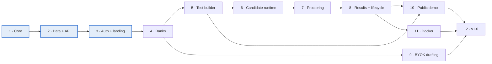

# Pariksha build roadmap

| | |
| --- | --- |
| **Status** | Active |
| **Last updated** | 2026-10-17 |
| **Implements** | [PRD.md](PRD.md) |
| **Design system** | [DESIGN.md](../DESIGN.md) |

The [PRD roadmap](PRD.md#roadmap) sets four *product* milestones — v0.1 pilot-ready, v0.2 teams and security, v0.3 all question types and grading, v1.0 public release. This document is the *build* order underneath them: twelve phases, each one shipping working, testable software, with the gate that has to pass before the next phase starts.

Read this with the PRD. Where the two disagree, the PRD wins on *what* and this file wins on *when*.

## Contents

1. [Progress](#progress)
2. [Phases](#phases)
3. [Gates](#gates)
4. [Dependency order](#dependency-order)
5. [Decisions that extend the PRD](#decisions-that-extend-the-prd)
6. [Mapping to PRD milestones](#mapping-to-prd-milestones)
7. [Plan documents](#plan-documents)
8. [What is needed from the operator](#what-is-needed-from-the-operator)

## Progress

Where the build actually stands. Update this table when a phase's state changes; the
per-phase sections below describe the *plan*, this table describes the *state*.

| Phase | State | Landed | Next |
| --- | --- | --- | --- |
| 1 — Foundation and scoring core | **Done** | `packages/core`: all 12 question types, all 5 scoring modes, seeded shuffling, pool draws, set assignment, import rules. Monorepo, CI, 173 tests. Merged as [#134](https://github.com/SriSatyaLokesh/pariksha/pull/134) | Four small items deferred from its review: [#130](https://github.com/SriSatyaLokesh/pariksha/issues/130)–[#133](https://github.com/SriSatyaLokesh/pariksha/issues/133) |
| 2 — Data and API platform | Not started | — | `packages/db`, `packages/storage`, `apps/api`. Needs live Cloudflare credentials ([what is needed from the operator](#what-is-needed-from-the-operator)) |
| 3 — Organiser auth, roles, first run and landing page | **Part done** | Design tokens generated from `DESIGN.md` ([#31](https://github.com/SriSatyaLokesh/pariksha/issues/31)) and the web shell, design-system components and landing page ([#32](https://github.com/SriSatyaLokesh/pariksha/issues/32)), on branch `phase-3/design-tokens-and-landing` | Cloudflare hosting is configured and committed; publishing it is a later session's work. Next are the auth tasks [#25](https://github.com/SriSatyaLokesh/pariksha/issues/25)–[#30](https://github.com/SriSatyaLokesh/pariksha/issues/30) and [#33](https://github.com/SriSatyaLokesh/pariksha/issues/33), all of which need Phase 2's API first |
| 4–12 | Not started | — | Planned in detail when their turn comes |

**The landing page is independent of the API** — it is static output with no backend call,
which is why Phase 3's tasks 7 and 8 could ship ahead of Phase 2. The rest of Phase 3
(sign-in, the first-run wizard, the dashboard) consumes `/api/v1/*` and cannot start until
Phase 2 exists.

**Plans are executed with [superpowers subagent-driven-development](https://github.com/obra/superpowers)**:
one implementer subagent per task, a spec-and-quality review after each, and a ledger at
`.superpowers/sdd/<plan-name>/progress.md` recording every completed task, every deferred
minor finding and every ruling made while the plan ran. That ledger is git-ignored and
local to the machine that ran it — read it before resuming a part-done phase, and if it is
gone, `git log` plus the closed issues are the record.

## Phases

### Phase 1 — Foundation and scoring core

**Delivers.** pnpm + Turborepo monorepo, strict TypeScript, ESLint, Prettier, Vitest, a CI job that lints, type-checks and tests every pull request. `packages/core` as pure TypeScript with no I/O: all 12 question types, all 5 scoring modes, attempt aggregation, seeded shuffling, pool draws and set assignment, and the cross-field import rules from [question-format.md](question-format.md#rules-checked-on-import).

**Why first.** It is the only part of Pariksha that depends on nothing, is the hardest to retrofit correctness into, and is the piece every later phase calls. Doing all 12 types now rather than 6 (as the PRD's v0.1 proposed) costs little, because the types are pure functions and the JSON Schemas already define them.

**Gate.** `AC-06`, `AC-07`: for every type, a fixture of correct, partly correct, wrong and blank answers yields the expected points under every scoring mode that applies. CI green on pull requests.

**Plan.** [`superpowers/plans/2026-10-16-phase-1-foundation-and-scoring.md`](superpowers/plans/2026-10-16-phase-1-foundation-and-scoring.md)

### Phase 2 — Data and API platform

**Delivers.** `packages/db` (Drizzle schema and migrations for D1, SQLite and Postgres, with a parity test between dialects, and a workspace-scoped repository layer), `packages/storage` (R2, S3 and local-disk adapters with short-lived signed URLs), `apps/api` (Hono application with a Workers entry and a Node entry, typed environment parsing, error envelope, security headers, `/api/v1/health`), and `deploy/cloudflare` (`wrangler.toml`, a setup script that creates the D1 database and R2 bucket, and the first real deployment).

**Gate.** Migrations apply cleanly on D1, SQLite and Postgres in CI. A deployed Worker answers `/api/v1/health`. The repository layer has no exported function that can read without a workspace ID, proved by test. No endpoint exceeds a stated subrequest budget ([ADR 0002](adr/0002-cloudflare-reference-stack-with-adapters.md)).

**Plan.** [`superpowers/plans/2026-10-16-phase-2-data-and-api-platform.md`](superpowers/plans/2026-10-16-phase-2-data-and-api-platform.md)

### Phase 3 — Organiser auth, roles, first run and landing page

**Delivers.** OIDC (authorization code with PKCE, any discovery-capable provider) and email magic link; sessions as HttpOnly cookies with hashed server-side records; workspaces, memberships and the full permission matrix enforced server-side; the append-only audit log; the first-run wizard that creates the instance owner and the first workspace; `apps/web` as a React + Vite application with design tokens generated from `DESIGN.md`; and the public landing page.

**Why here.** The PRD deferred workspaces and sign-in to v0.2. Both the public demo and BYOK key storage need a workspace with an owner and a server-enforced permission check, so auth moves ahead of the candidate runtime. Everything after this phase is built inside a workspace.

**Gate.** `AC-23`: for every role in the permission matrix, each allowed action succeeds and each other action returns 403; a member of workspace A gets 404 for any workspace-B resource. A fresh deployment reaches a signed-in, empty dashboard — landing page, sign-in, wizard, dashboard — in under 30 minutes (`AC-01`, partial).

**Plan.** [`superpowers/plans/2026-10-16-phase-3-auth-roles-and-landing.md`](superpowers/plans/2026-10-16-phase-3-auth-roles-and-landing.md)

### Phase 4 — Question banks and authoring

**Delivers.** Bank CRUD, the bank browser with type, tag and difficulty filters, an editor for each of the 12 types with live preview, Markdown, LaTeX and code rendering, and import and export: Pariksha JSON (all types), CSV (single, multiple, true/false, numeric, fill in the blank) and Moodle GIFT. Import is all-or-nothing with a line-by-line error report.

**Gate.** `AC-05`. Every type can be authored, previewed and round-tripped through export and import with no loss.

**PRD.** `D-01`, `D-02`, question-format.md.

### Phase 5 — Test builder and lifecycle

**Delivers.** Tests with name, `tst_` ID, slug, short link and QR code; sections with fixed lists, random pools and sets; shuffling with per-attempt layouts; the registration form builder with all 11 field types and their validation; access mode configuration; timing and navigation; the Draft → Scheduled → Open → Closed → Archived lifecycle with numbered published versions; clone; and whole-test JSON export and import.

**Gate.** `AC-02`, `AC-03`, `AC-04`, `AC-09`, `AC-10`, `AC-11`.

**PRD.** `T-01` through `T-24`.

### Phase 6 — Candidate runtime

**Delivers.** The candidate landing and start pages, all four access modes, server-side registration validation including unique fields, attempt creation with a pinned version and layout, the answer autosave path with an offline queue and idempotent server upsert, the server-authoritative timer, the three navigation modes, submit (manual, timeout and limit), automatic scoring and result release.

**Gate.** `AC-12` through `AC-16`, `AC-22`. Network off for two minutes mid-test loses no answers; a browser restart resumes the same questions, answers and remaining time.

**PRD.** `C-01` through `C-10`.

### Phase 7 — Proctoring

**Delivers.** The Off, Standard and Strict profiles and every control under them: device and browser gating, fullscreen, tab and window-switch detection, copy, paste and right-click blocking, the watermark, the camera requirement, identity photo, interval and violation snapshots to private storage, on-device face counting with MediaPipe, extra-monitor detection, violation limits with their configured action, and the integrity flag rule.

**Gate.** `AC-17` through `AC-21`. Proctoring failures never block answering.

**PRD.** `P-01` through `P-10`.

### Phase 8 — Results, monitoring, grading and data lifecycle

**Delivers.** The live monitor with proctor actions, the per-attempt review page, the manual grading queue with blind and by-question grading, reviewer verdicts, test analytics and item analysis, the results, responses and events CSVs, the snapshot ZIP, webhooks with HMAC signatures and retries, scoped API keys, and the retention and candidate-deletion jobs.

**Gate.** `AC-24`, `AC-25`, `AC-27`, `AC-28`. **Pilot gate** (PRD G1): one real test with 300 or more candidates finishes with zero lost answers.

**PRD.** `R-01` through `R-11`, `S-13`, `S-14`, `D-03`.

### Phase 9 — BYOK AI question drafting

**Delivers.** Per-workspace storage of an organiser-supplied Anthropic or OpenAI API key, encrypted at rest with the deployment's field-encryption key and never sent to the browser. A drafting flow that turns a topic, syllabus or pasted source text into questions in `pariksha/question@1` form, validated against the JSON Schema and the cross-field import rules before anything is stored. Drafts land in a bank as unpublished items an Author must review; nothing is ever auto-published. Per-workspace usage and spend display, and a hard cap the owner sets.

**Gate.** A generated batch that fails schema validation is rejected whole with its errors, exactly like a bad import. No request to a provider is made without a key belonging to the calling workspace. No key value is readable through any API response.

**Extends the PRD** — see [Decisions that extend the PRD](#decisions-that-extend-the-prd).

### Phase 10 — Public demo instance

**Delivers.** A demo workspace provisioned per visitor, seeded with a sample bank, a published sample test and fake attempts with scores and integrity flags, so an evaluator sees a populated product rather than an empty one. A Cron Trigger wipes demo workspaces on a fixed schedule, reusing the Phase 8 retention job. Demo workspaces are rate-limited, cannot send email, cannot hold a BYOK key and cannot be published to a custom domain.

**Gate.** A visitor reaches a populated workspace from the landing page without signing in. The reset job removes every demo workspace and its storage objects. No demo action can touch a non-demo workspace.

**Extends the PRD** — see [Decisions that extend the PRD](#decisions-that-extend-the-prd).

### Phase 11 — Docker self-host

**Delivers.** The API container (also serving the web app), Postgres 16 and SQLite paths, MinIO and local-disk storage, Caddy for automatic HTTPS, `docker compose up` with an `.env` file, email and password sign-in with Argon2id plus optional TOTP (Docker only, per `S-01`), the built-in scheduler in place of Cron Triggers, and documented backup and restore.

**Gate.** `AC-01` on the Docker path. The full acceptance suite passes on Docker + Postgres as well as on the Cloudflare free plan.

**PRD.** `O-03`, architecture table.

### Phase 12 — v1.0 release readiness

**Delivers.** The WCAG 2.1 AA audit and its fixes, translation files and right-to-left layout, the OpenAPI 3.1 description, the plugin interface for question types, proctoring signals and export targets, the k6 load-test script, the full documentation set (quick start, organiser guide, candidate FAQ, security guide, API reference, privacy template), semantic-versioned signed releases and dependency scanning.

**Gate.** `AC-29`: a k6 run of 500 candidates on the Cloudflare free plan ends with under 0.5% errors, p95 at or under 300 ms, and usage inside the daily limits. Every acceptance criterion passes on both deployment targets.

**PRD.** `O-04` through `O-07`, non-functional requirements.

## Gates

| After | Gate | Passes when |
| --- | --- | --- |
| Phase 1 | Scoring correctness | Every type × every applicable mode matches its fixture |
| Phase 3 | Platform | Permission matrix and tenant isolation suites pass; fresh deploy reaches a dashboard |
| Phase 6 | First live test | A real unproctored test runs end to end with zero lost answers |
| Phase 8 | Pilot (PRD G1) | 300+ candidates, zero lost answers, results CSV matches hand-scoring |
| Phase 12 | v1.0 | Every acceptance criterion on both targets; k6 at 500 candidates inside free limits |

## Dependency order

Phases 9 and 10 are off the critical path. Phase 9 needs only banks (Phase 4) and encrypted workspace settings (Phase 3); Phase 10 needs a publishable test (Phase 5) and the retention job (Phase 8). Either can slip without delaying v1.0's critical chain.

## Decisions that extend the PRD

Three items in this roadmap are not in the PRD. Each is recorded here as a decision, with what it costs. Each needs its own ADR before its phase starts.

### Public demo instance (Phase 10)

The PRD lists "a hosted SaaS run by the project" as a non-goal. A public demo is adjacent to that line, and the distinction has to be held deliberately: the demo exists so an evaluator can see Pariksha without deploying it, and it is not a place anyone runs a real test. Demo workspaces are provisioned per visitor, wiped on a schedule, rate-limited, unable to send email, unable to hold a BYOK key, and unable to take a custom domain. Someone — not the project generically — must own the Cloudflare account it runs on and the abuse surface it opens.

### BYOK AI question drafting (Phase 9)

Anthropic and OpenAI, keys supplied by the organiser and stored encrypted per workspace with the existing field-encryption key (`S-15`), never returned by any API and never present in the browser. The model drafts *questions into a bank*, not whole tests: a generated question is an unpublished draft in `pariksha/question@1` form, validated against the JSON Schema and the cross-field import rules, which an Author reviews before it can be used. This keeps the blast radius at one bank item and reuses the import path's validation wholesale. Generating entire `pariksha/test@1` documents — sections, timing, registration form — is explicitly out of scope and would need its own decision.

Pariksha itself ships no model keys and makes no outbound AI request on its own behalf. A deployment with no key configured behaves exactly as it does today.

### Auth moved ahead of the candidate runtime

PRD v0.1 ships a pilot test with an access code and defers workspaces, roles and organiser sign-in to v0.2. This roadmap moves them into Phase 3, because the landing page, the demo and BYOK all need a workspace with an owner and a server-enforced permission check to exist first, and because retrofitting tenant scoping into a schema that was written without it is the expensive mistake this ordering avoids.

### Smaller calls made while planning

These are the planner's calls, not the PRD's. They are listed so they can be overruled cheaply.

- **All 12 question types land in Phase 1**, not spread to v0.3. They are pure functions over data the schemas already define; splitting them costs more than finishing them.
- **Negative marking may take a single question below zero; a section total and an attempt total are clamped at zero.** The PRD fixes the per-question rule and is silent on the aggregate. Clamping keeps percentage, rank and pass/fail meaningful.
- **Points are rounded to two decimal places at the question, section and total boundaries.** Partial-credit fractions otherwise surface as `7.199999999999999` in a CSV.
- **All timestamps are stored as integer epoch milliseconds** in every dialect, so SQLite and Postgres cannot drift on date handling.
- **Design tokens are generated from `DESIGN.md`'s front matter** into `tokens.css` and `tokens.ts` by a build script, so the design system stays the single source and no hex value is retyped.
- **Package manager is pnpm with Turborepo**, as `.gitignore` already assumes (`.pnpm-store/`, `.turbo/`).

## Mapping to PRD milestones

| PRD milestone | Phases | Note |
| --- | --- | --- |
| v0.1 Pilot-ready | 1 – 6 | Auth arrives here rather than in v0.2; all 12 types rather than 6 |
| v0.2 Teams and security | 7 – 8 | Roles and audit log already shipped in Phase 3; this adds proctoring, retention and deletion |
| v0.3 All types and grading | 8 – 10 | Grading, analytics and regrade, plus the two additions |
| v1.0 Public release | 11 – 12 | Docker, API surface, accessibility, translations, plugins, docs |

## Plan documents

Detailed, task-by-task implementation plans live in [`docs/superpowers/plans/`](superpowers/plans/). Phases 1 to 3 are planned in full. Phases 4 to 12 are scoped above and planned in detail when their turn comes, because a plan written against code that does not exist yet is rewritten before it is read.

## What is needed from the operator

Phase 2 is the first phase that cannot finish without live credentials.

| Needed | Used for | Phase |
| --- | --- | --- |
| Cloudflare account ID | `wrangler.toml`, deployments | 2 |
| Cloudflare API token (Workers, D1, R2, Pages edit) | CI deployment and the setup script | 2 |
| A domain or a `workers.dev` subdomain | Candidate and admin URLs | 2 |
| An OIDC client ID and secret (Google, Microsoft or GitHub) | Organiser sign-in | 3 |
| A transactional email sender, free tier | Magic links, invites, one-time codes | 3 |
| A Turnstile site key and secret | Registration bot protection | 6 |
