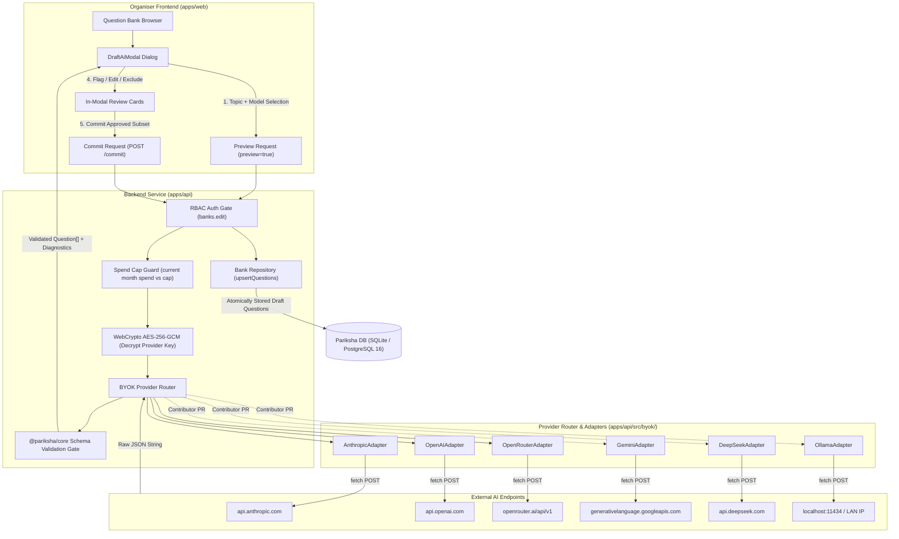
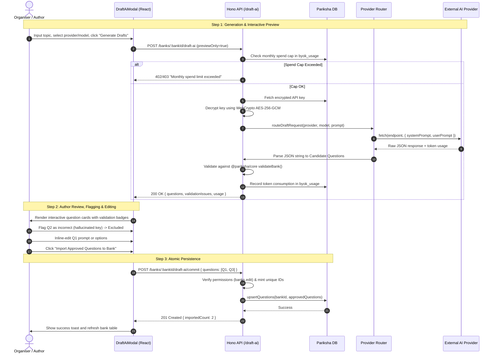
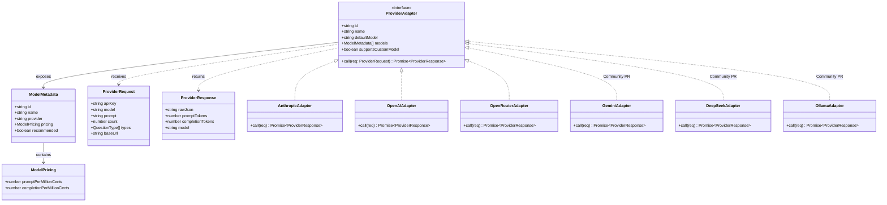
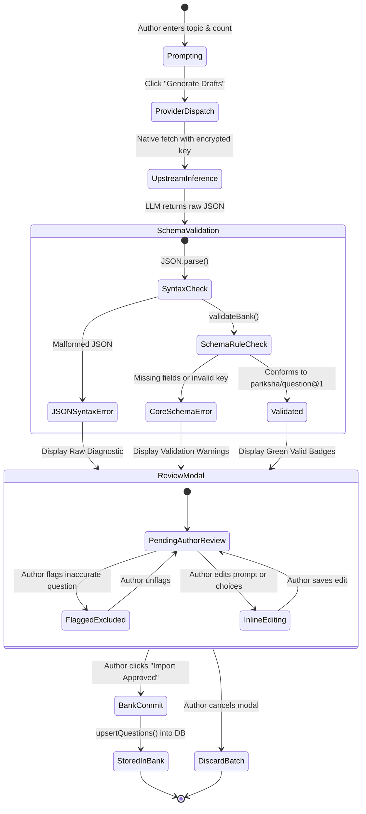

# RFC & Contributor Issue: Extensible AI Model Router & Provider Adapters

**Target Milestone:** Post-Phase 12 / Community Contributions  
**Issue Labels:** `rfc`, `help wanted`, `good first issue`, `ai-router`, `enhancement`  
**Status:** Open for Review & Contribution  

---

## 1. Issue Summary

Pariksha is a local-first, zero-knowledge assessment engine running across Cloudflare Workers, Node.js, and Docker self-hosted environments. 

In Phase 12, we introduced **Bring-Your-Own-Key (BYOK) AI Question Drafting**, allowing educators to connect their own API keys (encrypted at rest with AES-256-GCM and guarded by hard monthly spend caps) to generate valid `pariksha/question@1` questions directly from course topics, syllabi, or raw texts.

To avoid vendor lock-in and enable rapid integration of new AI models without modifying core business logic, Pariksha is opening its **Provider Router** architecture to the community. We are inviting contributors to implement dedicated adapters for:
- 🟢 **Google Gemini** (`gemini-2.0-flash`, `gemini-1.5-pro`, `gemini-1.5-flash`)
- 🔵 **DeepSeek** (`deepseek-chat`, `deepseek-reasoner`)
- 🟣 **Local Ollama & vLLM** (Air-gapped, on-premises local open-source models like `llama3.3:70b`, `qwen2.5:32b`, `mistral-small`)
- 🟠 **Mistral AI** (`mistral-large-2411`, `codestral-2501`)

---

## 2. Core Constraints & Guarantees

Every provider adapter must conform strictly to Pariksha's architectural principles:
1. **Zero External AI SDKs:** No `@google/genai`, `@anthropic-ai/sdk`, `openai`, or `ollama` npm packages. All requests must use standard native `fetch` and WebCrypto (`crypto.subtle`). This keeps our Cloudflare Worker bundle lightweight (<1 MB) and eliminates dependency supply-chain risks.
2. **Zero-Knowledge Key Secrecy:** Decrypted API keys are held exclusively in ephemeral Worker/Node memory for the duration of the upstream HTTP request. Keys are never logged, never returned in HTTP responses, and never stored in the browser.
3. **Structured Schema Validation (Gate 1):** Upstream models must be instructed to output strictly valid JSON adhering to Pariksha's `pariksha/question@1` schema. Validation is enforced by `@pariksha/core` before any question enters the question bank.
4. **Atomic In-Modal Preview & Flagging:** Questions generated by any adapter are first presented in an interactive modal for human review. Authors can flag and discard hallucinations or incorrect keys, edit options inline, and commit only approved items to the bank as drafts.

---

## 3. Technical Architecture Review

### 3.1 End-to-End System Architecture



---

### 3.2 Two-Step Drafting Sequence Diagram



---

### 3.3 Provider Adapter Class Diagram



---

### 3.4 Question Drafting State Machine



---

## 4. Contributor Implementation Guide

### Directory Layout
```
apps/api/src/byok/
├── index.ts              # BYOK public exports
├── crypto.ts             # WebCrypto AES-256-GCM encryption/decryption
├── types.ts              # ProviderAdapter, ModelMetadata, Request/Response
├── models.ts             # Model registry and standard pricing catalog
├── router.ts             # Provider router dispatching to registered adapters
├── prompts.ts            # System and user prompt builders for pariksha/question@1
├── draft.ts              # Spend cap check, validation gate, bank upsert
└── adapters/
    ├── anthropic.ts      # Anthropic Claude adapter
    ├── openai.ts         # OpenAI GPT adapter
    ├── openrouter.ts     # Generic OpenAI-compatible / OpenRouter adapter
    ├── gemini.ts         # 🌟 Community Target: Google Gemini
    ├── deepseek.ts       # 🌟 Community Target: DeepSeek
    └── ollama.ts         # 🌟 Community Target: Local Ollama / vLLM
```

---

### Implementation Example: Google Gemini Adapter

Here is a reference implementation showing how concise a new provider adapter can be using standard `fetch`:

```typescript
// apps/api/src/byok/adapters/gemini.ts
import type { ProviderAdapter, ProviderRequest, ProviderResponse } from "../types.js";
import { buildSystemPrompt, buildUserPrompt } from "../prompts.js";

export class GeminiAdapter implements ProviderAdapter {
  readonly id = "gemini";
  readonly name = "Google Gemini";
  readonly defaultModel = "gemini-2.0-flash";
  readonly supportsCustomModel = true;

  readonly models = [
    {
      id: "gemini-2.0-flash",
      name: "Gemini 2.0 Flash",
      provider: "gemini",
      pricing: { promptPerMillionCents: 10, completionPerMillionCents: 40 },
      recommended: true,
    },
    {
      id: "gemini-1.5-pro",
      name: "Gemini 1.5 Pro",
      provider: "gemini",
      pricing: { promptPerMillionCents: 125, completionPerMillionCents: 500 },
    },
  ];

  async call(req: ProviderRequest): Promise<ProviderResponse> {
    const systemPrompt = buildSystemPrompt(req.types);
    const userPrompt = buildUserPrompt(req.prompt, req.count);
    const model = req.model || this.defaultModel;

    const endpoint = `https://generativelanguage.googleapis.com/v1beta/models/${model}:generateContent?key=${req.apiKey}`;

    const res = await fetch(endpoint, {
      method: "POST",
      headers: { "Content-Type": "application/json" },
      body: JSON.stringify({
        system_instruction: { parts: [{ text: systemPrompt }] },
        contents: [{ role: "user", parts: [{ text: userPrompt }] }],
        generationConfig: {
          response_mime_type: "application/json",
          temperature: 0.2,
        },
      }),
    });

    if (!res.ok) {
      const err = await res.text().catch(() => "");
      throw new Error(`Gemini API error (${res.status}): ${err || res.statusText}`);
    }

    const data = await res.json();
    const rawJson = data.candidates?.[0]?.content?.parts?.[0]?.text ?? "";
    const promptTokens = data.usageMetadata?.promptTokenCount ?? 0;
    const completionTokens = data.usageMetadata?.candidatesTokenCount ?? 0;

    return { rawJson, promptTokens, completionTokens, model };
  }
}
```

---

## 5. Testing & Verification Checklist for Contributors

Before submitting a Pull Request, verify:
- [ ] **No External AI SDKs:** Ensure `package.json` contains no new dependencies.
- [ ] **Mocked Unit Test:** Add `apps/api/test/byok/<provider>.test.ts` testing:
  - Successful response mapping and token extraction.
  - Upstream 401/429/500 error translation without leaking the API key.
- [ ] **Schema Conformance:** Verified output passes `@pariksha/core` `validateQuestion`.
- [ ] **Monorepo Suite Green:**
  ```bash
  pnpm --filter @pariksha/api test
  turbo run typecheck
  turbo run lint
  ```

---

## 6. How to Claim an Adapter
Reply to this issue specifying which provider you'd like to build (e.g., *"I'd like to build the Gemini adapter"* or *"I'll take the Ollama adapter"*). The core team will assign the issue to you!
