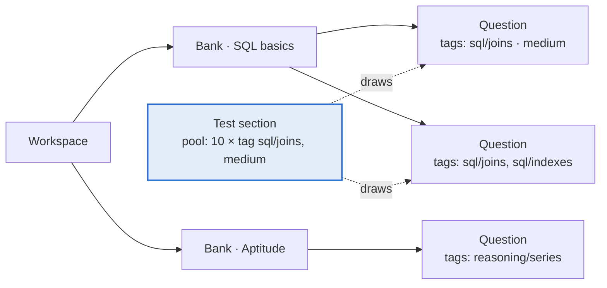
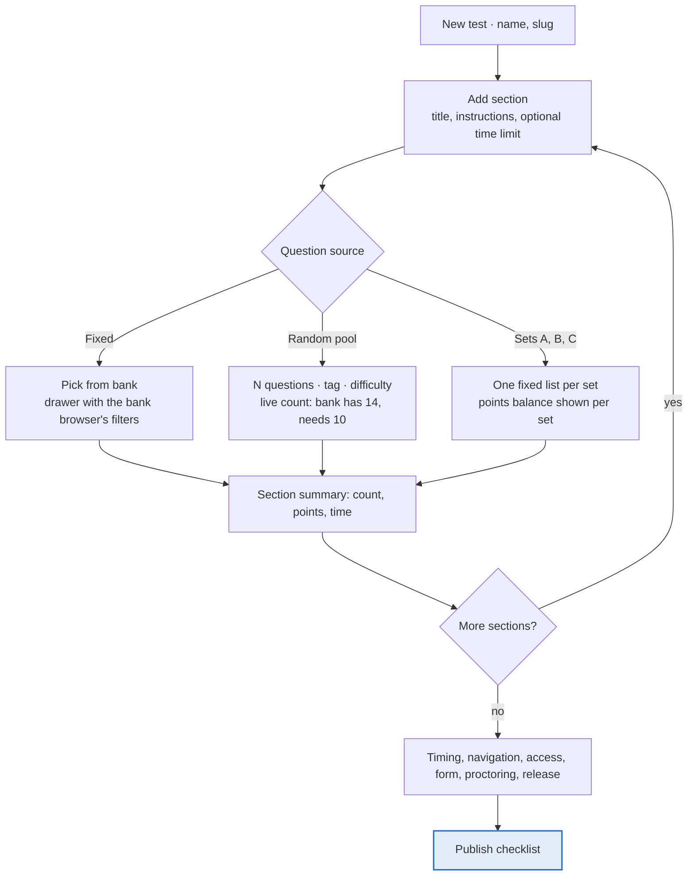
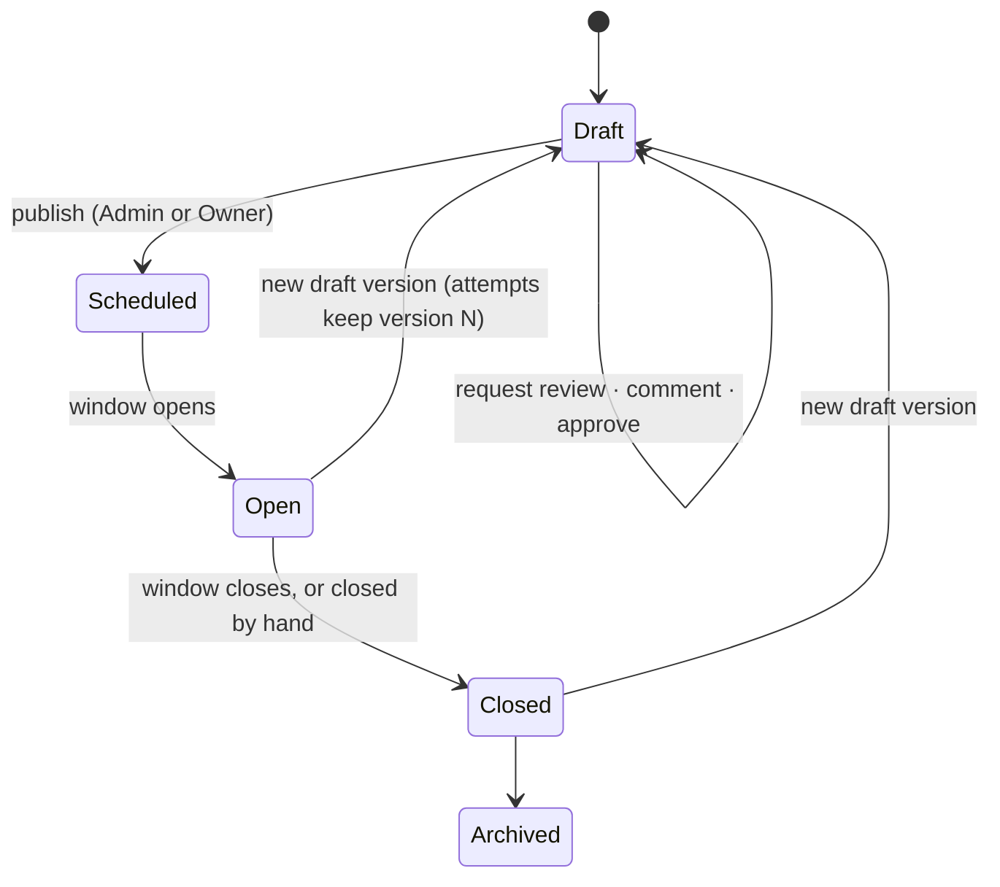

# Design: the organiser authoring experience

| | |
| --- | --- |
| **Status** | Draft |
| **Last updated** | 2026-10-17 |
| **Author** | Satya K |
| **Implements** | [PRD.md](PRD.md) sections 2–5, [question-format.md](question-format.md), [test-format.md](test-format.md) |
| **Builds for** | [ROADMAP.md](ROADMAP.md) Phase 4 (question banks and authoring) and Phase 5 (test builder and lifecycle) |
| **Visual language** | [DESIGN.md](../DESIGN.md) — tokens, type scale, components |
| **Source** | Shriya Shekhar, *[Student Exam Portal Design — A UX case study](https://uxplanet.org/student-exam-portal-design-a-ux-case-study-486d9b9e2418)*, UX Planet, 2020 |

This is the *interaction* design for the side of Pariksha an organiser sees: how a question
gets written, how a bank gets organised, how a test gets assembled from it, and how a test
gets reviewed and published. [DESIGN.md](../DESIGN.md) at the repository root is a different
document — it is the visual design system (colour, type, spacing, component specs) and this
file consumes it rather than restating it.

The candidate runtime (Phase 6) and proctoring (Phase 7) already have an agreed flow in the
PRD and are out of scope here, except where an authoring decision constrains them.

## Contents

1. [What the source case study contributes](#what-the-source-case-study-contributes)
2. [Validating its model against Pariksha](#validating-its-model-against-pariksha)
3. [Roles: who does what](#roles-who-does-what)
4. [Flow 1 — organising a bank](#flow-1--organising-a-bank)
5. [Flow 2 — authoring a question](#flow-2--authoring-a-question)
6. [Flow 3 — building a test](#flow-3--building-a-test)
7. [Flow 4 — review, publish, version](#flow-4--review-publish-version)
8. [The editor](#the-editor)
9. [Screen inventory](#screen-inventory)
10. [Decisions that need an ADR](#decisions-that-need-an-adr)
11. [What was rejected and why](#what-was-rejected-and-why)

## What the source case study contributes

The case study designs an examiner-facing portal for institutions in Singapore, built by a
team of five over eight months with design sprints inside scrum. Its scope was three flows —
create questions, create an exam paper, conduct an exam. Four things in it are worth taking,
and they are the backbone of this document.

1. **One editing skeleton for every question type.** Its hardest requirement was "different
   types of questions under a similar UI experience". It solved it by customising one rich
   editor (TinyMCE, cut down to the few controls examiners actually need) and swapping only
   the answer block underneath. Pariksha has 12 types — three times their four — so this
   matters more here, not less. See [the editor](#the-editor).
2. **Authoring starts from content, not from the test.** Their flow begins "choose a topic, or
   create one", and the paper is assembled later from what exists. Pariksha's PRD implies the
   same order (banks exist, tests draw from them) but has never said it in interaction terms.
   Said here: **UX-01**.
3. **Content is shared, not owned by a test.** Examiner B can pull topics authored under
   Examiner A's module. Any model where a question belongs to exactly one paper fails this.
4. **A paper is reviewed by other humans before it goes live.** Their paper sits in *review
   mode*, more reviewers can be added, sections are rearranged, and only then is it published.
   Pariksha's lifecycle has publishing but no review step. This is the one real gap the case
   study exposes — see [UX-10](#flow-4--review-publish-version).

Two things in it are explicitly *not* taken: its Course → Module → Topic hierarchy, and its
audio and video question types. Both are argued in
[what was rejected](#what-was-rejected-and-why).

> The case study's screenshots are hosted on Medium and were not retrievable as images while
> writing this; everything above is drawn from its text, which describes each flow in full. If
> a screen below contradicts one of its mockups, this document is the one that is wrong.

## Validating its model against Pariksha

| Case-study concept | Pariksha equivalent | Verdict |
| --- | --- | --- |
| Course | *none* — a workspace holds tests directly | Not adopted. A workspace is already the unit of ownership (PRD, Roles and permissions) |
| Module | *none* | Not adopted |
| Topic (a question belongs to one topic) | `tags: ["sql", "joins"]` on a question | Covered, and better: tags are many per question, so the "Examiner B reuses Examiner A's topic" case is free |
| Question bank per topic | Bank (`pariksha/bank@1`), a named list of questions | Covered |
| Question types: MCQ, multi-select, paragraph, fill in the blank | 12 types including `single`, `multiple`, `select_k`, `long_answer`, `fill_blank` | Pariksha is a superset |
| Video and audio questions | Images only (`media.kind: "image"`) | **Gap**, deliberate — see [rejected](#what-was-rejected-and-why) |
| Paper with customisable sections | Sections with fixed lists, pools or sets (`T-07`, `T-08`) | Pariksha is a superset: the case study has no pools and no sets |
| Add questions to a section later | Allowed; a section can be empty in Draft, `T-11` warns before publish | Covered |
| Paper in review mode, reviewers added | *none* — Draft → Scheduled → Open → Closed → Archived (`T-04`) | **Gap** — [UX-10](#flow-4--review-publish-version) |
| Rearrange sections while in review | Draft is freely editable (`T-04`) | Covered |
| Publish the paper to conduct it | Publishing freezes a numbered version (`T-04`) | Covered, and stronger: attempts pin their version |
| Chief examiner / question-bank admin / exam-paper admin | Owner / Author / Admin, plus Proctor, Reviewer, Viewer | Covered — [roles](#roles-who-does-what) |

Net: of eleven concepts, Pariksha already covers or improves on nine. Two are gaps — one of
which (paper review) this document closes, and one of which (media types) it declines for v1.

## Roles: who does what

The case study's three personas map onto roles that already exist in the PRD's permission
matrix. No new role is needed.

| Case study | Pariksha role | Authoring surfaces they reach |
| --- | --- | --- |
| Super admin / chief examiner | **Workspace owner** | Everything below, plus members, branding, retention |
| Question bank admin (subject expert) | **Author** | Banks, questions, test drafts. Cannot publish, cannot see candidate data |
| Exam paper admin | **Admin** | Everything an Author reaches, plus publish, open, close, archive, candidate lists |
| (no equivalent in the case study) | **Reviewer** | Reviews a draft test (**new**, UX-10); grades manual answers; sets integrity verdicts |

The split that matters: **an Author can build a whole test but cannot make it live.** That is
already in the matrix — "Create, edit, clone tests" is Y for Author, "Publish, open, close,
archive" is blank — and the interface has to make the boundary obvious rather than failing at
the last click. See [UX-11](#flow-4--review-publish-version).

## Flow 1 — organising a bank

**UX-01.** Authoring is bank-first. A question is created inside a bank and tagged; a test is
assembled afterwards by drawing from banks. Creating a test is never a prerequisite for
writing a question.

**UX-02.** A bank is created with a name and nothing else required. Licence, description and
default tags are editable later. One field, one click, then straight into writing — the case
study's "choose a topic or create a new one" without the modal detour.

**UX-03.** Tags are free text with autocomplete over tags already used in the workspace, and
`/` is allowed inside one (`sdlc/agile`). A tag containing a slash renders as a breadcrumb chip
in filters and groups the bank browser's left rail. This buys the case study's Module → Topic
reading with no schema change, no migration and no second CRUD surface: a question tagged
`sdlc/agile` and `exam/midterm` sits under two "modules" at once, which their model needed a
link table to express.



**UX-04.** The bank browser is a table, not a card grid: prompt excerpt, type, difficulty, tags,
points, last edited, used-in-N-tests. Filters for type, tag, difficulty and "not used in any
test" sit in a left rail. Rows select with a checkbox so a set of questions can be tagged,
moved, exported or deleted at once — the one bulk affordance the case study lacked, and the one
that hurts most at a few hundred questions.

**UX-05.** Deleting a question that a published version references is refused, and the refusal
names the tests that hold it. Pariksha pins attempts to a version, so running attempts are safe
either way; the refusal exists so an Author does not silently gut a paper that is about to run.

## Flow 2 — authoring a question

```mermaid
flowchart TD
    A["Bank browser · New question"] --> B["Pick a type<br/>12 cards, grouped: choice · match · written"]
    B --> C["Prompt: Markdown, media, code, LaTeX"]
    C --> D["Answer block — the only part that changes by type"]
    D --> E["Key and scoring: points, mode, negative fraction"]
    E --> F["Meta: difficulty, tags, explanation, passage group"]
    F --> G{"Valid against<br/>schemas/question-1.json?"}
    G -- no --> H["Inline errors on the offending field"]
    H --> D
    G -- yes --> I["Save · Save and add another"]
    I --> A
    C -. "live preview, candidate's view" .-> P["Preview pane"]
    D -. .-> P
```

**UX-06.** The type is picked first and can be changed afterwards. Changing it keeps the prompt,
media, tags, difficulty and explanation, and drops only the answer block, after a confirmation
naming exactly what will be lost.

**UX-07.** One screen, five stacked blocks, same order for all 12 types: **prompt → answer → key
and scoring → meta → preview**. Only the answer block's contents differ. This is the case
study's central lesson, applied to three times as many types.

| Block | `single`, `multiple`, `select_k`, `true_false`, `assertion_reason` | `matching`, `multi_matching`, `ordering` | `fill_blank`, `numeric` | `short_answer`, `long_answer` |
| --- | --- | --- | --- | --- |
| Answer block | Option rows: drag handle, rich text, correct toggle, pin toggle | Two item columns (left, right), or one ordered list; drag to reorder | Blanks read out of the `{{id}}` placeholders in the prompt, one row each; numeric gets value and tolerance | Max length; model answer, or rubric rows |
| Key | Set on the option rows themselves | Checkbox grid for `multi_matching`; for `ordering` the written order *is* the key | Accepted answers per blank with `exact`, `case_insensitive` or `regex` | None (manual), or the rubric levels |
| Scoring modes offered | all-or-nothing, negative; partial for `multiple` and `select_k` | all-or-nothing, partial; `position` for `ordering` | all-or-nothing, partial, negative | rubric |

The scoring row offers only the modes the type supports. That is the same constraint
`packages/core` already enforces, surfaced in the UI so an invalid combination cannot be
entered in the first place.

**UX-08.** `ordering` is authored in the correct order and shuffled for candidates, and the
editor says so under the list. It is the one type where what the author sees is deliberately
not what the candidate sees.

**UX-09.** Preview is a pane beside the editor showing the candidate's view, with an "as the
reviewer sees it" toggle that reveals the key and the explanation. It is the same renderer the
candidate runtime uses. Alt text is required before an image saves (`media.alt`), and the
preview is where that is checked.

## Flow 3 — building a test



**UX-12.** Sections are the spine of the builder: listed vertically, dragged to reorder, each
collapsible to a single row showing *title · source · question count · points · time*. The case
study found that examiners reason about a paper as "Section A is 20 marks" — the collapsed row
is that sentence.

**UX-13.** Adding questions is optional at every step. A section may be empty in Draft and the
whole test stays editable until publish; the publish checklist (UX-17) is where emptiness
becomes an error rather than a nag. This is the case study's explicit finding — examiners build
the shape first and fill it later — and it matches `T-11`.

**UX-14.** Picking fixed questions opens a drawer over the builder, not a separate page, with
the bank browser's filters and a running "12 selected · 24 points" footer. The builder stays
visible behind it, so an author never loses the shape of the paper while filling it.

**UX-15.** A pool section shows its draw live: "10 drawn from 14 matching · medium ·
`sql/joins`". When the match count falls below the requested count the row takes the
`flag-risk` token and the publish checklist blocks (`T-11`).

**UX-16.** Sets show a points-balance strip, one bar per set, so the `T-11` warning about sets
differing in total points is visible while building rather than only at the gate.

## Flow 4 — review, publish, version

This is the flow where Pariksha gains something from the case study rather than confirming it.

**UX-10 — a draft can be sent for review.** A Draft test gets a flag, `review_requested`, and a
list of reviewers drawn from workspace members. Setting it does three things: the test shows an
"In review" badge in the test list, the named reviewers see it in a review queue, and each can
comment on a section or a question and mark their own review *Approved* or *Changes requested*.
The test stays in **Draft** throughout and stays freely editable.

**No new lifecycle state.** The case study's "review mode" is a state because its papers had
nowhere else to live. Pariksha's Draft already means "freely editable, not live", which is
exactly what review needs. A sixth state would add transitions, permission-matrix rows and a new
failure mode — a paper stuck in review when its reviewer leaves the workspace — in exchange for
a badge that renders from a boolean.



**UX-11 — the publish boundary is shown, not discovered.** An Author sees the Publish button in
place and disabled, with "Needs an Admin — request review instead" beside it, rather than a 403
after a full build. The permission is still enforced on the server for every request; this is
only about not wasting the author's work.

**UX-17 — a publish checklist, not a publish button.** Publishing opens a checklist that has to
be all green: every section has questions or a satisfiable pool, every pool has enough matches,
sets are within the configured points tolerance, the registration form has at least one unique
field if repeat registration is to be blocked, and the availability window is in the future.
Each failing row links to the thing that is wrong.

**UX-18 — later edits are a new version.** Editing a published test creates draft version N+1
and says so in one line: "Version 2 (draft). Attempts in progress stay on version 1." The case
study had no versioning and had to tell examiners by hand not to touch a live paper; Pariksha's
version pinning (`T-04`) turns that rule into a note.

## The editor

The case study spent real effort here — a proof of concept across several editors, then TinyMCE
cut down to the controls examiners use — and arrived at "just enough features to accommodate all
types of questions". Pariksha reaches the same place from the other side, because `prompt` is
already **Markdown** in `pariksha/question@1`, not HTML.

**UX-19.** The prompt editor is a Markdown text area with a small toolbar (bold, italic, list,
link, code block, image, LaTeX, table) and the live preview pane of UX-09. No WYSIWYG document
tree, no HTML sanitisation surface, and the stored value is exactly what a JSON export carries.

Why this and not a rich editor: the format already fixes the ceiling. A WYSIWYG editor that can
produce anything Markdown cannot express produces questions that fail
`schemas/question-1.json` on export, so it would have to be constrained back down to Markdown —
which is the proof of concept the case study ran, ending at a stripped-down toolbar. Starting
from Markdown skips it.

**UX-20.** Images upload through `packages/storage` and are referenced by `media.src` with
required `alt`. Code blocks are fenced with a language for highlighting. LaTeX is `$…$` inline
and `$$…$$` display, rendered in the preview so an author sees a broken formula before a
candidate does.

**UX-21 — `fill_blank` is authored in the prompt.** Typing `{{1}}` in the prompt creates blank
`1`, and the answer block grows a row for it with its accepted answers and match mode. Deleting
the placeholder deletes the row. The case study gave fill-in-the-blank its own editor screen;
tying each blank to the text it lives in is both less UI and harder to get out of sync.

## Screen inventory

Everything above, as the set of screens Phases 4 and 5 have to build.

| # | Screen | Phase | Decisions it implements |
| --- | --- | --- | --- |
| 1 | Bank list | 4 | UX-02 |
| 2 | Bank browser — table, filters, bulk select | 4 | UX-03, UX-04, UX-05 |
| 3 | Question type picker | 4 | UX-06, UX-07 |
| 4 | Question editor with preview pane | 4 | UX-07 – UX-09, UX-19 – UX-21 |
| 5 | Import and export dialog — JSON, CSV, GIFT | 4 | all-or-nothing with a line-by-line report (`AC-05`) |
| 6 | Test list — state, version, "In review" badge | 5 | UX-10 |
| 7 | Test builder — sections | 5 | UX-12, UX-13, UX-15, UX-16 |
| 8 | Question picker drawer | 5 | UX-14 |
| 9 | Test settings — timing, navigation, access, form, release | 5 | `T-12` – `T-24` |
| 10 | Review panel — reviewers, comments, approvals | 5 | UX-10, UX-11 |
| 11 | Publish checklist | 5 | UX-17 |
| 12 | Version banner and history | 5 | UX-18 |

Visual treatment for all twelve comes from [DESIGN.md](../DESIGN.md): cream and ink surfaces,
hairline rules, JetBrains Mono for every label, count, ID and code sample, and voltage reserved
for the primary action and the focus ring. The authoring side is an editing tool, not a
marketing page — the full-bleed voltage block appears in none of these screens.

## Decisions that need an ADR

1. **UX-03, hierarchical tags.** A `/` in a tag carries a Module → Topic reading in the UI only;
   nothing in `pariksha/question@1` changes. If grouping ever needs permissions or ownership
   ("Examiner A owns `sdlc/*`"), that is a schema decision and needs its own ADR first.
2. **UX-10, review comments.** Settled in [ADR 0007](adr/0007-review-comments-on-a-draft-test.md):
   comments never export with the test, a comment carries `anchor_kind`/`anchor_id`, commenting
   gets its own permission action added by the task that builds it, and a resolved thread is a
   state on the thread, never a deletion.

## What was rejected and why

**Course → Module → Topic as tables.** Three CRUD surfaces, a link table for the shared-topic
case the case study spends a whole section on, and a required two-level choice before anyone can
write a question — to express grouping that `tags` already expresses with no schema at all, and
without limiting a question to one group. The case study needed the hierarchy because its
sponsor sold to institutions whose org chart *was* the hierarchy; Pariksha ships into a
workspace that may be a college, a hiring team or one person. UX-03 keeps the reading and drops
the tables.

**Video and audio question types.** `pariksha/question@1` allows `media.kind: "image"` only.
Audio and video mean storage cost, bandwidth on the candidate's connection during a timed
attempt, accessibility obligations (captions, transcripts) and a per-type playback policy —
"can it be replayed, and how often" — which is a scoring question, not a media question. None of
that fits v1's zero-cost principle. If it returns, it returns as a format version bump with that
policy designed, not as an editor feature.

**A sixth lifecycle state for review.** Argued at [UX-10](#flow-4--review-publish-version).

**A WYSIWYG question editor.** Argued at [UX-19](#the-editor).
