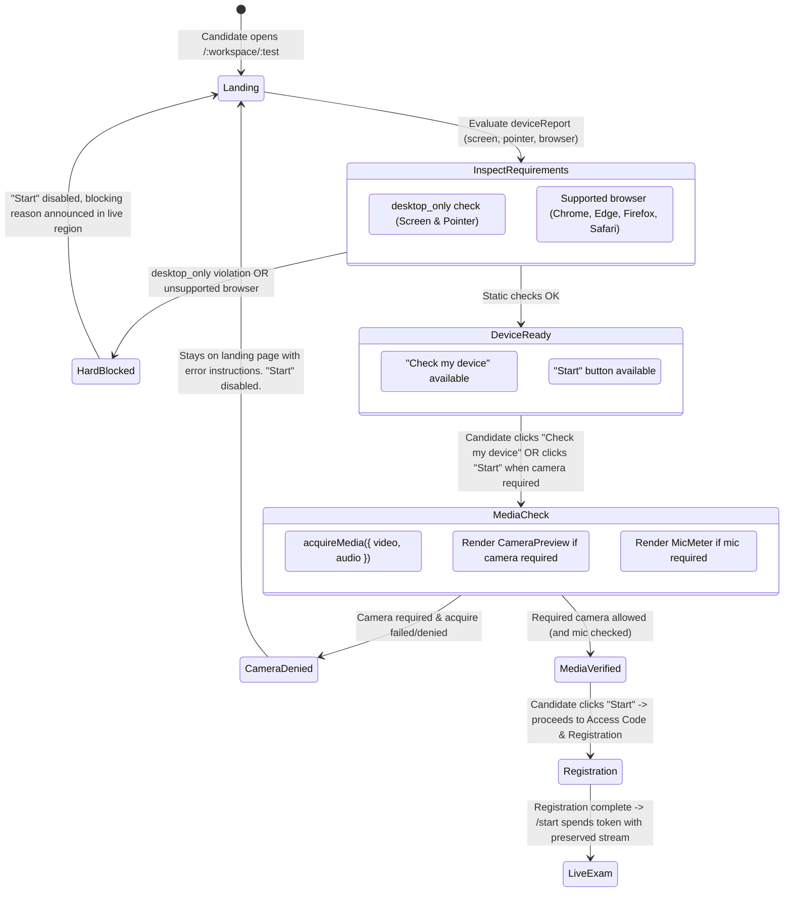

# Design Specification: Landing Page Device & Proctoring Check Gate

- **Date:** 2026-10-28
- **Author:** Antigravity & Satya K
- **Status:** Proposed (Brainstorming alignment)
- **Target Release:** Phase 8.5+ candidate onboarding UX hardening
- **Related Issues / PRs:** PR #266, Issue #209, Issue #265

---

## 1. Problem Statement
When a test organiser configures proctoring (e.g., `desktop_only`, `require_camera`, or supported browser rules):
1. **Late Rejection**: Currently, candidates whose browser is unsupported or who do not have a working camera can click "Start" on the landing page, navigate to the access code entry screen (`/register`), enter their access code, fill out candidate registration fields (name, email, roll number), accept consent terms, and click "Register and start". Only then does `startWith` attempt joint media acquisition and bounce them back to the landing page with `CAMERA_GATE_MESSAGE`.
2. **Unsupported Browser Not Hard-Gated**: In `deviceReport`, `browserOk === false` only rendered an advisory warning (`!`), without setting `refused: true`, allowing candidates on unsupported browsers to proceed into the registration flow.
3. **Disconnected "Check my device"**: If a candidate clicks "Check my device" on the landing page and the camera check fails (`cameraNotice` is shown), the "Start" button remains enabled.

Candidates must be stopped upfront on the landing / device check page: they must verify their environment, allow required camera/microphone devices, and pass compatibility checks *before* being allowed to proceed to the access code and registration screens.

---

## 2. Goals & Invariants
- **Upfront Gating**: If proctoring is enabled and requirements fail (unsupported browser, non-desktop device under `desktop_only`, or missing/denied camera under `require_camera`), the candidate remains on the landing check page and cannot advance to the access code or registration screen.
- **Stay on Check Page to Allow**: If camera is required and not yet allowed, clicking "Start" activates the device check inline on the landing page, prompts the candidate for permission, and only allows advancing once the required media check succeeds.
- **Fail-Open Preservation (`AG1`)**: Non-blocking proctoring requirements (microphone noise monitoring) continue to fail open under `AG1`. If joint audio fails or is denied, the audio degradation notice is shown, but the candidate may proceed once camera (if required) is verified.
- **Zero Audio Storage (`P-06`, `AG2`, `AG3`)**: Privacy guarantees remain untouched; only device presence and noise amplitude are inspected.
- **Stream Preservation**: When media permission is granted on the landing page, the active `MediaStream` is held and handed forward to the exam runner, preventing jarring duplicate browser permission prompts when transition to `/start` occurs.
- **Accessible & Responsive**: Follows Signal Design System conventions and WCAG 2.5.3 superset labels (`aria-describedby`, `role="status"`).

---

## 3. Architecture & User Flow



---

## 4. Detailed Component Changes

### 1. `apps/web/src/routes/exam.tsx`
- **`deviceReport` Enforcement**:
  Update `deviceReport` to factor in `browserOk` when proctoring is active:
  ```ts
  const browserBlocked = anyControlActive && !browserOk;
  const desktopBlocked = resolved.desktopOnly && (!screenOk || !pointerOk || isMobileUA);
  const refused = desktopBlocked || browserBlocked;
  ```
  Provide distinct messages for `exam-device-blocked` explaining whether it is a non-desktop device or an unsupported browser.
- **Landing Gate on "Start" Click**:
  In `ExamLanding`:
  - If `requiresCamera(test)` is true and `deviceMediaStream` does not have an active video track:
    Clicking "Start" automatically triggers `handleCheckDevice()`, opens the device test panel inline, and prompts for media permission.
    The view stays on the landing page with the preview visible.
  - If the camera check fails or is denied:
    Display the camera blocked warning inline (`CAMERA_GATE_MESSAGE`). The candidate cannot navigate to registration until they grant camera access.
  - If camera check succeeds (or if camera is not required):
    Proceed to `onStart(deviceMediaStream)`.
- **Stream Preservation in `ExamApp`**:
  Lift the acquired `landingMediaStream` into `ExamApp` state so that `ExamLanding` hands it to `startWith`, ensuring no redundant `getUserMedia` re-prompts after registration.

### 2. Signal Design System & Accessibility
- **Landing Layout Hierarchy Update**:
  As the proctoring requirements list grows (camera, microphone, browser, fullscreen, copy-paste, watermark, multi-monitor, etc.), place the main call to action buttons (`.exam-landing-actions`: "Check my device", "Start", "See my result") **above** the `.exam-landing-requirements` section. This keeps the primary interaction immediately visible above the fold on standard laptops without candidates needing to scroll through an extensive requirements list to find Start.
- The inline device test section keeps its accessible region (`aria-label="Device test preview"`).
- `Start` button uses `aria-describedby="exam-device-blocked"` which announces either the desktop or browser refusal.
- When camera permission is required, the camera gate announcement is delivered via `role="status"` so screen readers immediately inform the candidate what permission is needed.

---

## 5. Failure Modes & Edge Cases
1. **Candidate denies camera on first prompt**:
   - The device preview remains open on the landing page.
   - Message: *"This test needs a working camera to start. Allow camera access and try again."*
   - Candidate clicks "Try again" / "Check my device" after enabling camera in browser settings.
2. **Unsupported Browser (e.g. In-app webview, legacy browser)**:
   - "Start" is disabled.
   - Finding displays `Browser: Not recognised. Use a fully updated Chrome, Edge, Firefox or Safari.`
   - Status announcement explains why the button cannot be clicked.
3. **Microphone missing or denied when mic is required (`requireMicrophone: true`)**:
   - Camera succeeds, mic shows notice: *"Microphone not detected. You may still take the test."*
   - Under `AG1`, candidate can click "Start" and proceed to registration.
4. **Resumed Attempt (`boot()`)**:
   - Already-registered candidates returning to a live attempt bypass landing and use the resume flow with reacquired media.

---

## 6. Verification Plan
- **Unit & Component Tests (`apps/web/test/exam/device-gate.test.tsx`, `camera-gate.test.tsx`)**:
  - Test `deviceReport` refuses unsupported browsers when proctoring is active.
  - Test clicking "Start" without camera verified does not navigate to registration; stays on landing and opens device check.
  - Test camera permission failure disables/blocks advancing to registration.
  - Test camera permission success enables advancing to registration.
- **End-to-End Browser Tests in Chromium (`apps/web/e2e/measurement/microphone.spec.ts`)**:
  - Verify candidate stays on landing page during device check.
  - Verify candidate only advances to access code after device check requirements pass.
  - Verify complete workflow in real Chromium with fake devices.
