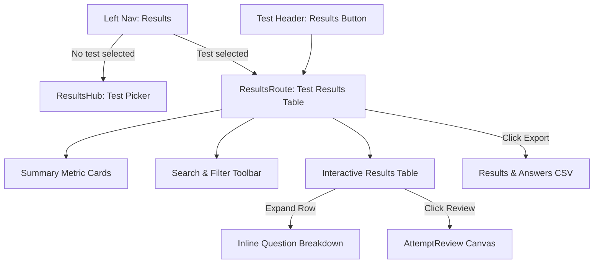

# Results Hub & Candidate Results Table Specification

| | |
| --- | --- |
| **Status** | Approved / Implemented |
| **Last updated** | 2026-10-28 |
| **Target** | Pariksha Admin / Organiser Workspace (`apps/api`, `apps/web`) |
| **Approach** | Approach A (Dedicated Results Hub & Test Results Route) |

---

## 1. Context & Motivation

Pariksha includes robust post-exam evaluation capabilities:
- A scoring engine in `@pariksha/core`.
- Comprehensive database repository functions in `packages/db/src/repo/results.ts` (`listAttemptsForTest`, `rankedScoresForTest`, `countedFiguresForTest`, `responsesForAttempts`).
- An analytical engine for cohort metrics, pass rates, item facility, and discrimination curves (`analytics.tsx`).
- A per-attempt proctoring review page (`AttemptReview.tsx` / `attempt.tsx`) displaying webcam snapshots, violation timelines, and candidate response text.
- CSV export endpoints for results and answer dumps.

### The Missing Piece
Despite these capabilities, **there is currently no in-browser results screen where an administrator or teacher can inspect candidate scores**. 
- To see who scored what, organisers are forced to leave the web application and download a CSV spreadsheet.
- The setting row named "Results" in the Test Builder (`ResultsPanel.tsx`) only configures release policies (immediate vs date-based) and data retention rules; it displays zero candidate scores.
- The comprehensive per-attempt review component (`AttemptReview.tsx`) is effectively orphaned because no table in the UI links to it.

This specification designs a **first-class Results Hub** in the left navigation sidebar and a **Candidate Results Table** within each test with expandable per-question drill-downs and direct links into the attempt review canvas.

---

## 2. Invariants & Constraints

1. **50-Subrequest Budget (Cloudflare Workers):**
   - The test results endpoint must fetch attempts, candidate identity, and scores in bounded, indexed batch queries.
   - Keyset cursoring must be supported for large candidate cohorts (e.g., 500+ candidates).
2. **Multi-Dialect Parity:**
   - Query patterns must execute seamlessly across SQLite (Miniflare/local) and PostgreSQL 16 (Docker production) without dialect divergence.
3. **Pure Policy & Role Enforcement:**
   - Reading results requires `results.export`, held by `(owner, admin, reviewer, viewer)`. This matches `GET .../analytics`, `GET .../export/results.csv`, and `GET .../export/answers.csv`. Authors who do not hold `results.export` cannot view candidate score sheets.
4. **Zero Key or Rubric Leakage (`KG1`):**
   - Candidate results endpoints return candidate responses, awarded points, and question prompts. They must never return private scoring keys, author rubrics, or explanations for active unreleased exams.
5. **Payload Efficiency:**
   - The workspace overview endpoint (`GET .../results/overview`) provides aggregate statistics in 2 batched queries.
   - The test results endpoint (`GET .../tests/:testId/results`) pages attempts with a default page size of 50 (max 100), avoiding payload bloat. Question breakdown is populated directly from `attempt.score_json.perQuestion` (which is already stored in the attempt record) and mapped against question prompts.
6. **Accessibility & Responsive Polish (WCAG 2.1 AA):**
   - Numerical figures must use tabular figures (`font-variant-numeric: tabular-nums`).
   - Touch targets must meet the 44px minimum.
   - Screen-reader announcements for pass/fail and integrity states must not rely on color alone.

---

## 3. Goals, Non-Goals, and Anti-Goals

### Goals
- **Left Navigation Entry:** Add "Results" to the sidebar navigation rail (`OrganiserShell.tsx`), allowing organisers to browse all workspace tests and their aggregate completion stats.
- **Direct Test Navigation:** Add a prominent "Results" action button in the test header toolbar alongside *Analytics* and *Grading queue*.
- **Interactive Results Table:**
  - View all candidate attempts for a selected test: Rank, Candidate Name/Email, Attempt Status, Score, Percentage, Pass/Fail status, Integrity flag, and Submission Date.
  - Search by candidate name, email, or external ID.
  - Filter by attempt status (Submitted, In Progress, Auto-submitted, Locked) and integrity flag (Clean, Review, Scoring Blocked).
  - Sort by rank/score, name, or submission date.
- **Inline Question Drill-Down:** Clicking an expand toggle (`▼`) on any candidate row unfolds a breakdown of every question in that candidate's set: prompt excerpt, points earned vs max points, and status.
- **Direct Attempt Review Link:** An action button on each row immediately opens the full [AttemptReview](file:///D:/professional/code/SriSatyaLokesh/pariksha/apps/web/src/components/organiser/AttemptReview.tsx) screen.
- **Export Actions:** Direct "Export Results CSV" and "Export Answers CSV" buttons accessible at the top of the Results table.

### Non-Goals
- Modifying test grading or regrading algorithms (already handled in Phase 8b / `GradingQueue.tsx`).
- Live socket streaming (proctoring live monitoring is handled in `Monitor.tsx`).

### Anti-Goals
- **No Monolithic Overload:** Do not cram candidate attempt lists into the psychometric analytics screen (`analytics.tsx`).
- **No Silent Truncation:** If a test has more than 500 attempts, the UI must paginate cleanly using keyset cursors rather than silently clipping candidates.

---

## 4. Approaches Considered

| Approach | Description | Pros | Cons | Verdict |
| :--- | :--- | :--- | :--- | :--- |
| **Approach A: Dedicated Results Hub & Route** | New `results.tsx` route, new `ResultsTable.tsx` component, new API endpoint `GET .../results`, left rail nav entry. | Clean modular architecture, follows existing Pariksha patterns (`monitor.tsx`, `analytics.tsx`), seamless deep linking. | Requires adding one route and component. | **Selected** |
| **Approach B: Embed in Analytics** | Place candidate table at the bottom of `analytics.tsx`. | Fewer files created. | Bloats `analytics.tsx` (>1200 lines), mixes aggregate statistical curves with per-candidate evaluation. | Rejected |
| **Approach C: Embed in Live Monitor** | Add score columns to `MonitorTable.tsx`. | Consolidates candidate tables. | Blurs the line between live exam monitoring (15s polling, room messages) and post-exam grading. | Rejected |

---

## 5. System Design & Architecture



### 5.1 API Design (`apps/api`)

#### Route 1: `GET /api/v1/workspaces/:id/results/overview`
- **Authorization:** `requires("results.export")`.
- **Purpose:** Supplies workspace-level aggregate results to the Results Hub without N+1 HTTP calls.
- **Budget:** 6 subrequests.
- **Response Payload:**
```json
{
  "tests": [
    {
      "id": "tst_123",
      "name": "Midterm Examination",
      "slug": "midterm-2026",
      "state": "closed",
      "candidateCount": 42,
      "attemptCount": 40,
      "submittedCount": 38,
      "averageScore": 76.5,
      "passRate": 0.84
    }
  ]
}
```

#### Route 2: `GET /api/v1/workspaces/:id/tests/:testId/results`
- **Authorization:** `requires("results.export")`.
- **Query Parameters:**
  - `status?: "submitted" | "in_progress" | "locked" | "all"`
  - `integrity?: "clean" | "review" | "scoring_blocked" | "all"`
  - `search?: string` (case-insensitive match on candidate name, email, or external ID)
  - `limit?: number` (default: 50, max: 100)
  - `cursor?: string` (keyset pagination based on `(started_at, id)`)
- **Budget:** 8 subrequests.
- **Response Payload:**
```json
{
  "test": {
    "id": "tst_123",
    "title": "Midterm Examination",
    "totalPoints": 100,
    "passMark": 60
  },
  "summary": {
    "totalRegistered": 42,
    "submittedCount": 38,
    "inProgressCount": 3,
    "lockedCount": 1,
    "averageScore": 76.5,
    "passRate": 0.84
  },
  "results": [
    {
      "attemptId": "att_abc123",
      "candidateId": "cnd_xyz789",
      "candidateName": "Jane Doe",
      "candidateEmail": "jane@example.com",
      "externalId": "STU-2026-001",
      "status": "submitted",
      "startedAt": 1793100000000,
      "submittedAt": 1793102400000,
      "durationSeconds": 2400,
      "score": 85,
      "maxScore": 100,
      "percentage": 85.0,
      "passed": true,
      "rank": 3,
      "integrityFlag": "clean",
      "violations": 0,
      "questionBreakdown": [
        {
          "questionId": "qst_001",
          "promptExcerpt": "What is the speed of light in vacuum?",
          "pointsEarned": 5,
          "maxPoints": 5,
          "correct": true
        }
      ]
    }
  ],
  "nextCursor": null
}
```

### 5.2 Frontend Components (`apps/web`)

1. **Left Rail Navigation (`OrganiserShell.tsx`):**
   - Add `{ key: "results", label: "Results" }` to `NAV`.
   - Reuses existing `ICONS.results`.
2. **Organiser Route Coordinator (`organiser.tsx`):**
   - Handles `view.kind === "results"`:
     - If `view.testId` is absent: renders `<ResultsHub />`.
     - If `view.testId` is present: renders `<ResultsRoute />`.
3. **Results Hub (`apps/web/src/routes/results-hub.tsx` or `ResultsHub.tsx`):**
   - Displays all workspace tests with published status, total registered candidates, submissions count, average score, and pass rate.
   - Each row has an *"Open results"* button that navigates to `?view=results&test=<testId>`.
4. **Test Results Screen (`apps/web/src/routes/results.tsx` & `ResultsTable.tsx`):**
   - Metric cards: Total Candidates, Submitted, Pass Rate, Class Average.
   - Filter bar: Candidate search input, status dropdown, integrity filter, sort controls.
   - Interactive table with sticky headers:
     - Rank column, candidate details (name, email), status badge, tabular score (`85 / 100`), percentage, pass/fail badge, integrity badge, submission date.
     - Expand button (`▼`) toggles inline accordion row displaying question-by-question breakdown.
     - "Review" button links to `go({ kind: "attempt", actor, workspace, attemptId, testId })`.
     - CSV export actions calling `client.exportResultsCsv` and `client.exportAnswersCsv`.
5. **Test Builder Header (`test.tsx`):**
   - Adds "Results" action button beside "Grading queue" and "Analytics".

---

## 6. What's Left to the Builder

- Exact CSS class naming conforming to `DESIGN.md` Signal design tokens.
- Loading skeleton and empty states when no candidates have attempted the test yet.
- Synthetic mock client fixtures for unit and component tests.
